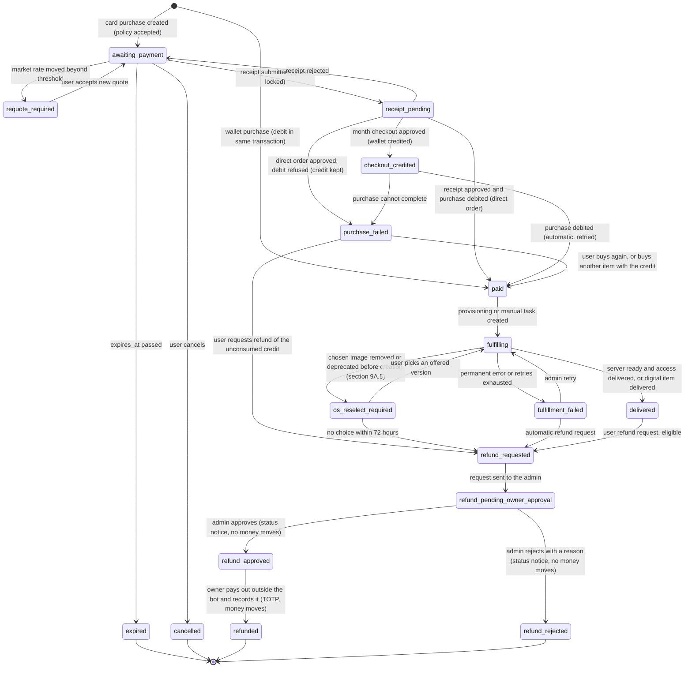
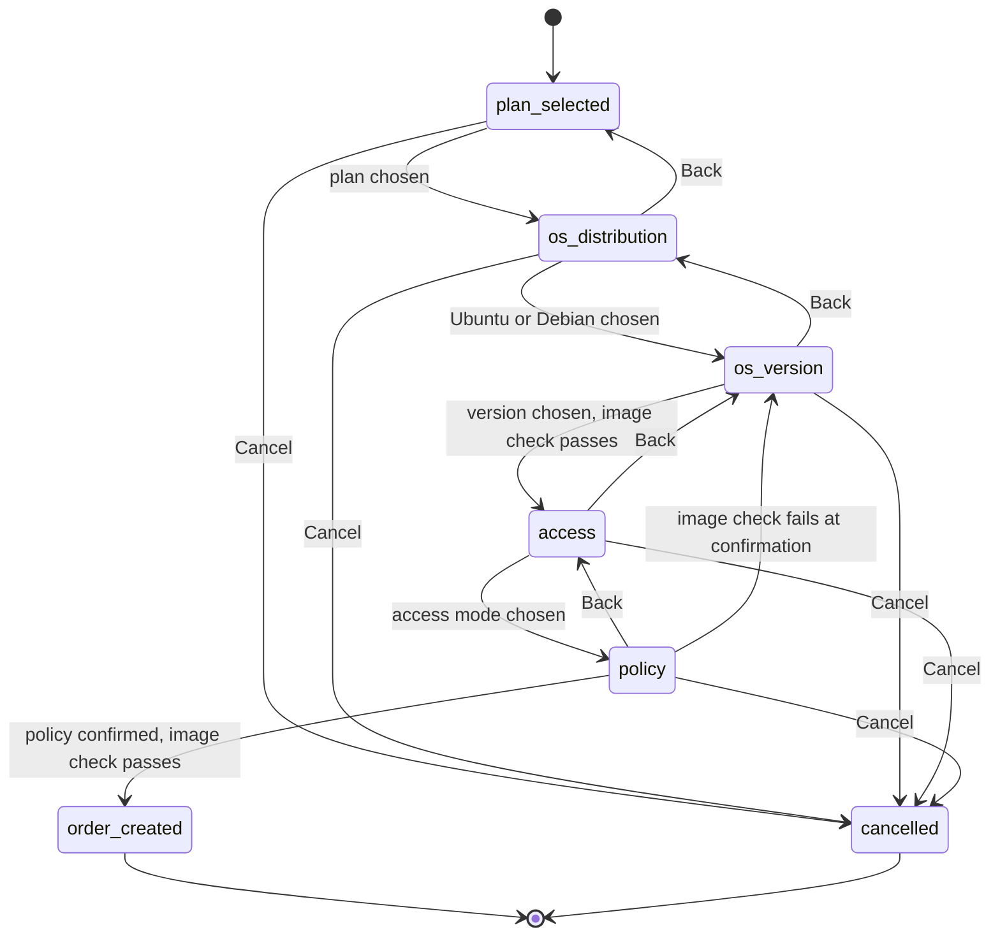

# shop_manovabot: System Design

Status: Revised after owner decisions, round 11 (2026-11-05). Round 11 overrides earlier rounds where they conflict on running-server price notices (removed), ARM (not in the first build), and the USD rate source (SwapWallet primary, Wallex fallback, section 4.3). Round 10 still applies on the OS list and the Hetzner token rule: versions are live from Hetzner's image list, and the project token rule is the owner's choice (sections 9A and 18.4). Round 9 still applies: a refund approval is a status notice, and only the TOTP-gated payout moves money (section 7). Rounds 6, 7, and 8 otherwise still apply, and round 5 (stopped servers billed at Hetzner's rate) still applies. Sources: `internal/owner-decisions-2026-11-05.md`, `internal/owner-decisions-round-2.md`, `internal/owner-decisions-round-3.md`, and `internal/owner-decisions-round-6.md`. Rounds 7 to 11 are owner instructions recorded in the changelog (section 27).
Language: Go
Scope: Telegram bot that sells Hetzner Cloud servers, then other digital products (Google AI Pro account, 12-month Google AI Pro family membership).

Conventions:

- Items without an owner decision use a stated default (section 26.2). Owner decisions are recorded in the changelog (section 27). Open owner questions are in section 26.1.
- Wallet and fee money is integer IRT (Toman).
- Exchange-rate parsing is specified separately in [usd-rate-source.md](usd-rate-source.md). The SwapWallet choice and its verification are recorded in [swapwallet-rate-verification-2026-11-05.md](../internal/swapwallet-rate-verification-2026-11-05.md) (round 11). This design defines only the interface the rate source must satisfy.
- Hetzner API action names are written as in the Hetzner Cloud API and must be verified at launch.

---

## 1. Goals and non-goals

**Goals**

- Sell Hetzner Cloud servers in Telegram with card payment confirmed by receipt, a two-currency wallet (Toman and USD) topped up by receipt (USD crypto screenshot top-ups are deferred, section 6.5), and a one-month checkout that credits the wallet first.
- Bill every minute a server exists, at Hetzner's hourly cost basis, exactly once. A minute is never lost and never charged twice, including across restarts, scheduler outages, provider outages, and power or network outages on the bot host (section 8).
- Show every buyer the segment, the floor, what happens at the floor, and the billing rules before any purchase is confirmed (section 9).
- Keep every Hetzner call within the global and per-user rate limits, queueing and retrying so that no request is dropped (section 10).
- Let users run rescue mode, reset the root password, and power their servers on and off from the bot, with authorization, confirmation, and rate limits (section 12).
- Gate sensitive admin actions with TOTP from an authenticator app. Nothing secret passes through Telegram.
- Deliver server access by SSH key, or by a one-time password reveal that never puts the password in chat.
- Price in USD and show the user both the USD base price and the rial amount.
- Run on the owner's singino machine as a service that restarts automatically, with long polling and no inbound Telegram port. Keep backups off the machine.
- Persian UI with English professional terms, with i18n support from the first release.
- Never store the Telegram token, Hetzner token, KEK, TOTP seeds, or card secrets in plaintext in the repository, the database, or logs. The one project-level exception for the Hetzner token is in section 18.4.

**Non-goals (MVP)**

- Any card gateway. The payment port exists, but no gateway adapter ships in MVP.
- Web storefront, reseller platform, multi-tenant use.
- Tax calculation. Items are tax-free (section 7.2).
- Full accounting. Export hooks only.
- Custom images, networks, load balancers, volumes, and Storage Box (a later item type).
- Multi-region active/active.
- Wallet withdrawals other than purchase refunds (not supported, section 26.2).

---

## 2. Roles and access

- Two roles: `USER` and `ADMIN`.
- The single `ADMIN` is the owner. Their Telegram ID is loaded from configuration (`ADMIN_TELEGRAM_ID`), not hardcoded and not committed to the repository.
- Users act only on their own wallet, orders, receipts, and servers. Admin commands are rejected for `USER` everywhere, including groups.
- Admin actions that move money, change the card, change floors, delete resources, or re-issue access require TOTP (section 14).
- User actions (rescue, password reset, power) use confirmation and rate limits, not TOTP (section 12.2).
- The support contact `@manova_support` is configuration (`SUPPORT_HANDLE`) and appears in menus and error messages.
- Google AI Pro products are sold by the bot and fulfilled manually by the `ADMIN`.

---

## 3. Domain model

### 3.1 Entities

| Entity | Purpose | Key fields and constraints |
|---|---|---|
| `User` | Telegram identity | `telegram_user_id` (unique), `role`, `locale` (default `fa`), `segment` (`NEW`, `CUSTOMER`, `LOYAL`), `blocked`, `deleted_at`, `first_purchase_state` (`eligible`, `consumed`, `forfeited`), `phone_hash` (keyed HMAC of the E.164 number, unique among active users), `phone_e164` (encrypted, the verified Iranian mobile number, `+989` form), `phone_verified_at`, set by Telegram contact sharing (section 6.7) |
| `Wallet` | Two balances: Toman and USD | `user_id` (unique), `balance_irt`, `balance_usd_micro`, `floor_override_irt` (nullable, set only through TOTP-gated admin action), `version` |
| `WalletLedger` | Append-only money movements, one currency per row | `wallet_id`, `currency` (`IRT` or `USD`), `amount` (signed; IRT, or USD micro-units), `kind`, `balance_after`, `ref_type`, `ref_id`; unique (`ref_type`, `ref_id`, `kind`, `currency`) |
| `CatalogItem` | Sellable item, versioned | Fields in 4.2 |
| `RateObservation` | Every value seen from the rate source, including edits | `market_irt_per_usd`, `source_ref`, `observed_at`; append-only |
| `CardAccount` | Receiving card number, editable by the `ADMIN` | `card_number` (in the database), `active`, `version`, `updated_by`. The holder name is configuration (section 6.4) |
| `Quote` | Price locked for an order | `usd_base_micro`, `market_irt_per_usd`, `sell_irt_per_usd`, `price_irt`, `checkout_credit_irt` (nullable, month checkout only, section 6.6), `observation_id`, `created_at`, `superseded_by` |
| `Order` | Purchase | `id` (UUID), `user_id`, `status`, `checkout_mode` (`direct`, `wallet`, `month_checkout`), `hold_reason` (nullable: `abuse_flag`, `admin_hold`; a hold pauses the debit and provisioning, section 6.9), `quote_id`, `card_account_id` (card orders), `policy_version`, `policy_accepted_at`, `expires_at`, `version` |
| `OrderItem` | Snapshot of what was bought | `order_id`, `catalog_item_id`, `config` (location, family, access mode, SSH key ref), `os_catalog_entry_id`, `os_distribution`, `os_version`, `hetzner_image_name`, `image_architecture`, `image_checked_at`, `hetzner_image_id_seen` (informational only, never used to create) (section 9A.6) |
| `OrderOsSelection` | Append-only OS choices for an order item | `order_item_id`, `distribution`, `version`, `hetzner_image_name`, `reason` (`initial`, `image_unavailable`), `chosen_by`, `chosen_at` |
| `OsCatalogEntry` | Synced cache of Hetzner's image list, one row per image and architecture (section 9A.2) | `id`, `distribution`, `version`, `architecture` (`x86` or `arm`), `image_name`, `hetzner_status` (`available`, `deprecated`, `missing`), `unavailable_after` (nullable), `offered` (derived: `available` and not deprecated), `display_name_fa`, `display_name_en`, `sort_order`, `synced_at`; unique (`image_name`, `architecture`) |
| `Receipt` | Proof of payment: a card transfer (IRR) or, once the deferred feature ships, a USD crypto screenshot (section 6.5) | `user_id`, `purpose` (`wallet_topup`, `order`, `usd_topup`), `order_id`, `quote_id`, `amount_irr` (card) or `amount_usd_micro` (USD), `tracking_code_norm` or `reference_norm` (unique), `image_sha256` (unique), `image_ref` (encrypted), `status`, `decided_by`, `decided_at`, `reason` |
| `ProvisionedResource` | Hetzner server we own and bill | `order_item_id`, `external_id`, `labels`, `status`, `power_state` (display only, changes no charge), `billing_start_at` (earlier of our create request and Hetzner `created`), `billing_end_at` (section 8.1), `posted_through`, `last_verified_at`, `remainder_micro_irt` |
| `ResourceEvent` | Append-only lifecycle and power events. Power events are informational and change no charge | `resource_id`, `kind` (`created`, `deleted`, `reopened`, `powered_on`, `powered_off`), `at`, `source` (`own_action`, `reconcile`, `provider_history`), `provider_ref` |
| `MinutePosting` | One minute of a server at the hourly cost basis (section 8.1) | `resource_id`, `minute_index`, `state` (`posted`, `reversed` for audited admin corrections only), `usd_micro`, `amount_irt`, `rate_observation_id`, `ledger_id`; unique (`resource_id`, `minute_index`, `posting_seq`) |
| `ServerAction` | User or admin action on a server | `resource_id`, `requested_by`, `kind` (`power_on`, `power_off`, `rescue_enable`, `rescue_disable`, `password_reset`), `state` (`queued`, `in_flight`, `succeeded`, `failed`, `cancelled`), `provider_action_ids`, `requested_at`, `finished_at`, `denial_reason` |
| `Credential` | Encrypted one-time password | `resource_id`, `kind` (`root_password`, `rescue_password`, `reset_password`), `state` (`pending_action`, `ready`, `consumed`, `discarded`), `ciphertext`, `key_id`, `reveal_token_hash`, `expires_at`, `consumed_at`, `superseded_by` |
| `RefundRequest` | Refund of a purchase. Approval is a status notice. The TOTP-gated payout is the only step that moves money (section 7.1) | `order_id`, `trigger` (`failed_purchase`, `fulfillment_failed`, `os_reselect_timeout`, `delivered_user_request`, `unused_credit`), `base_irt`, `commission_irt`, `payout_irt`, `card_last4`, `status` (`requested`, `pending_owner_approval`, `approved`, `paid_out`, `rejected`), `requested_at`, `approved_by_admin_id` (nullable), `approved_at`, `rejected_by_admin_id`, `rejected_at`, `reject_reason`, `bank_reference`, `paid_out_by_admin_id`, `paid_out_at` |
| `DeletionSchedule` | Floor-breach deletion with grace period | `resource_id`, `breached_at`, `delete_at`, `status` (`scheduled`, `executed`, `cancelled`, `extended`), `decided_by` |
| `ProviderRequest` | Queued Hetzner call (section 10) | `id`, `class` (`system_critical`, `provisioning`, `user_action`), `user_id`, `op`, `state`, `attempts`, `not_before`, `dispatched_at` |
| `AdminChallenge` | One-time TOTP challenge for a sensitive admin action | `admin_id`, `action`, `payload_hash`, `token_hash`, `expires_at`, `consumed_at`, `attempts` |
| `TotpCredential` | Admin TOTP enrollment | `admin_id`, `seed_ciphertext`, `key_id`, `last_used_step`, `failed_attempts`, `locked_until`, `active` |
| `RecoveryCode` | Single-use recovery codes | `admin_id`, `code_hmac`, `used_at` |
| `AdminAction` | Append-only privileged action log | `actor_telegram_id`, `action`, `target`, `reason`, `before`, `after` |
| `OrderEvent` | Append-only order history | `order_id`, `from_status`, `to_status`, `source`, `source_ref` |
| `TelegramUpdate` | Inbox for deduplication | `update_id` (primary key), `status`, `received_at` |
| `ConversationState` | Per-user flow state | `user_id` (primary key), `flow`, `step`, `data` (JSONB), `version`, `expires_at` |
| `ResourceEstimate` | Local cache of predictable prices and estimates (section 8.8) | `resource_id`, `hourly_irt`, `monthly_cap_irt`, `cost_month_to_date_usd_micro`, `runway_hours`, `estimate_at`, `inputs_version` |
| `Job` | Work queue | `kind`, `unique_key` (unique while active), `payload`, `attempts`, `run_at`, `locked_until`, `status` |

### 3.2 Order states



Rules:

- Transitions exist only in `domain/order`. Adapters cannot set a status.
- Each transition is one database transaction: versioned update of `orders`, an `order_events` row, and any follow-up `jobs` or `provider_requests` row (transactional outbox).
- Every transition records `source` and `source_ref`.
- Refund states (`refund_*`, `refunded`) change only together with the `RefundRequest` record, in the same transaction (section 7.3).
- A hold (`hold_reason`) is a flag on the order, not a state. It pauses the purchase debit and provisioning until an admin releases it (section 6.9).
- A receipt for an `expired` or `cancelled` order is a late payment. It credits the wallet and does not revive the order (section 6.3).
- `checkout_credited` is used only by month checkouts (section 6.6). `purchase_failed` is used for any paid order whose purchase debit or provisioning is refused before a server exists, for month checkouts and direct orders (section 6.9). Money credited in those states stays in the wallet until it is used or refunded. It is never lost by a failed purchase.

---

## 4. Pricing, FX, and money

### 4.1 Currencies and units

- Catalog base prices are in **USD**, stored as integer micro-dollars (`price_usd_micro`).
- Fees, segment thresholds, and floors are in **IRT (Toman)**, as integers. The wallet holds two balances: `balance_irt` (Toman) and `balance_usd_micro` (USD micro-units). Floors apply to their combined value (section 8.6).
- Payments are in **IRR (rial)**. 1 IRT = 10 IRR. A receipt amount must be a multiple of 10 IRR and converts as `amount_irt = amount_irr / 10`. Other amounts are rejected at intake.
- Rounding that affects a charge rounds up to a whole Toman. Floats are never used for money.
- Display: "تومان" for IRT and "ریال" for IRR, with thousands separators. Latin digits by default (section 26.2).

### 4.2 USD base price and sell rate

- **Market rate** `M`: IRT per USD, from the rate source (section 4.3).
- **Sell rate** `S = M + 5,000` IRT per USD. The spread is configuration (`RATE_SPREAD_IRT_PER_USD`).
- **Price in IRT**: `price_irt = ceil(price_usd_micro × S / 1,000,000)`.
- **Rial amount** shown to the user: `price_irt × 10`.
- Catalog items carry one USD hourly price, `hourly_price_usd_micro`, taken from the gross price in `/pricing` (section 4.2). It is used for billing and display. Stopped servers are billed at the same price (section 8.1). The round 3 off-rate is removed (decided in round 5).
- Catalog fields otherwise follow round 1: name, family, vCPU, RAM (at most 16 GB), SSD, monthly reference price, Hetzner server type mapping, and allow-lists in `attributes`.

Price source: `GET /pricing` returns prices in the account currency, EUR or USD, which is fixed per account (facts section 7). Each price has `net` and `gross` values, and `pricing.vat_rate` gives the VAT rate. The billing cost basis uses the gross hourly and monthly prices, so that the charge covers the VAT on Hetzner's invoice (default, section 26.2). The USD base in the catalog is shop-side. For an EUR account it is converted with the rate source (section 4.3), and the conversion is reconciled before launch (section 26.3).

Each quote shows the user the USD base, the rate used, the IRT price, and the rial amount. Example (illustrative market rate of 100,000 IRT per USD, not a real quote): an item at $0.10 per hour is 100,000 micro-USD. The sell rate is 105,000 IRT per USD. The price is `100,000 × 105,000 / 1,000,000 = 10,500 IRT` per hour, which is 105,000 IRR.

### 4.3 Rate source (interface only)

**Source choice (round 11, owner).** The primary source is SwapWallet's public market price, `USDT/IRT`. The fallback is Wallex `USDTTMN`. Verified facts and unverified items are in [swapwallet-rate-verification-2026-11-05.md](../internal/swapwallet-rate-verification-2026-11-05.md). Still to confirm before launch (section 26.3): whether SwapWallet's value is a buy or a sell price, and whether unauthenticated access stays allowed. A public Telegram price channel is a rejected option: it is a third party with no published method and posts hourly.

Any implementation must provide:

- **Port**: `FxRateSource` returns `RateObservation{market_irt_per_usd, observed_at, source_ref}`. `observed_at` is the shop's fetch time, because SwapWallet's response has no timestamp.
- **Source changes are observations.** When a value changes, the new value is stored as a new observation with the same `source_ref` and a new version. Nothing is overwritten.
- **Polled values are observations.** Each poll is stored with its fetch time and source reference.
- **Missed updates are detected.** The source is polled on a fixed schedule. A gap longer than `RATE_MAX_AGE_HOURS` (default 6) marks the rate stale.
- **Stale rate.** New quotes are refused while the rate is stale. Billing does not stop: it uses the last valid rate and raises an alert (section 8.2).
- **Manual rate.** Until the source is verified, the `ADMIN` sets the rate with an audited manual observation.

### 4.4 Quotes and re-quoting

- Every purchase creates a `Quote` with the USD base, market rate, sell rate, IRT price, and the observation used.
- **Fixed-price orders** (`awaiting_payment` with no receipt) are re-quoted when the market rate moves more than 5,000 IRT per USD from the rate at creation (`REQUOTE_THRESHOLD_IRT_PER_USD`). The order moves to `requote_required`, and the user must accept the new price.
- **A submitted receipt locks its quote.** Re-quoting never applies to an order that has a receipt.
- **Wallet purchases** are priced and debited at purchase time, so they have no re-quote window.
- **Billing** uses the rate in force for each minute (section 8.2). Running servers therefore follow the sell rate minute by minute (confirmed in round 6). A rate change on a running server is not notified to the user (round 11).

Re-quote example: the order was quoted at a market rate of 100,000 (sell 105,000, price 10,500 IRT for one hour). The market moves to 106,000. That is a 6,000 move, more than 5,000. The new sell rate is 111,000, the new price is 11,100 IRT, and the user must accept it.

### 4.5 Wallet ledger

- Every movement is a row in `wallet_ledger`, in one currency. `wallet.balance_irt` and `wallet.balance_usd_micro` are cached sums, updated in the same transaction under a row lock on the wallet.
- Ledger kinds: `topup_receipt` (IRT), `topup_usd_crypto` (USD), `checkout_credit` (IRT), `purchase`, `fee`, `usage`, `usage_reversal`, `refund_credit`, `refund_payout`, `refund_commission`, `admin_adjustment`.
- Idempotency: unique (`ref_type`, `ref_id`, `kind`, `currency`).
- **Debit order.** A debit (purchase, fee, or usage) takes the Toman balance first. The rest comes from the USD balance, converted at the sell rate in force and rounded up to the next USD micro-unit. Each currency gets its own ledger row. The default order is Toman first (section 26.2).
- **Valuation.** Combined value, in IRT, is `balance_irt + floor(balance_usd_micro × sell rate ÷ 1,000,000)`. Floors and runway use it (section 8.6). Confirmed in round 7: a floor is compared with the combined value rounded down to whole Toman.
- **Purchases are refused** if they would take the combined value below the segment floor. **Usage is never refused** (section 8.6 explains why).
- Property tests assert that each `balance_*` equals the sum of its ledger rows for every wallet.

---

## 5. Fee ladder, first-purchase promotion, and segments

### 5.1 Fee ladder

- A **purchase** is checkout of an order by card or wallet. For hourly items the purchase is the first 60-minute block (section 8.1). Usage charges are not purchases and carry no fee (default, section 26.2).
- `P`: the purchase amount in IRT before fees (the quoted price).
- `C`: the total of purchase amounts in the 30 days before this purchase, rolling, in IRT, before fees and adjustments (round 2). Two details use defaults (section 26.2): the current purchase is not counted, and refunded purchases are not subtracted.
- `f(C)`: `C < 1,000,000` gives 10%. `C < 10,000,000` gives 3%. Otherwise 1%.
- `fee = ceil(P × f(C))`, added on top: `total = P + fee`.
- The first-purchase promotion (5.2) overrides this formula for the first purchase only.

Worked examples:

- `P = 2,000,000` IRT and `C = 1,500,000` IRT. The rate is 3%. `fee = 60,000` and `total = 2,060,000` IRT.
- `C = 16,000,000` IRT is in the 1% bucket. A purchase of 2,000,000 IRT then carries a fee of 20,000 IRT.
- Boundary: if `C = 900,000` before the purchase, the rate is 10% and the fee is 200,000 IRT. Counting the current purchase would give `C = 2,900,000`, a 3% rate and a fee of 60,000 IRT. The difference is 140,000 IRT, so that default matters.

### 5.2 First-purchase promotion (confirmed)

Owner wording, confirmed in round 4 as written in round 3: the first purchase is fee-free up to 1,000,000 Toman, has a hard limit of 1,000,000 Toman, and any wallet top-up before the first purchase forfeits it permanently.

The numbered points below restate that wording as rules. Point 4's card-order detail is not covered by the confirmation. The default applies: a card order is not a top-up (section 26.2).


1. **Eligibility.** The user has no completed purchase and no approved wallet top-up. `first_purchase_state = eligible`.
2. **Hard limit.** While eligible, a purchase above 1,000,000 IRT is refused with a message that explains the first-purchase limit. A purchase of 1,000,000 IRT or less is fee-free.
3. **Consumption.** The promotion is consumed when the first purchase is paid, not when it is quoted. An abandoned quote does not consume it.
4. **Forfeiture.** Any approved wallet top-up (`topup_receipt` or `topup_usd_crypto`) before the first purchase sets `first_purchase_state = forfeited` permanently. A card order is a payment for that order, not a top-up, so it does not forfeit the promotion. This reading is not covered by the confirmation and stays open, because the card path credits the wallet internally (section 6.1).
5. **After consumption or forfeiture**, the ordinary fee ladder applies (5.1). With `C = 0` the rate is 10%.

Examples:

- Eligible user buys a first hour at 10,500 IRT: fee 0, total 10,500 IRT.
- Eligible user tries a first purchase of 1,500,000 IRT: refused under reading 2.
- User tops up 100,000 IRT by receipt, then buys a first hour at 10,500 IRT: promotion forfeited, `C = 0`, rate 10%, fee `ceil(10,500 × 10%) = 1,050`, total 11,550 IRT.

### 5.3 Segments

- `NEW`: default for every new user.
- `CUSTOMER`: `C` above 1,000,000 IRT.
- `LOYAL`: `C` above 10,000,000 IRT.
- Segment uses the same 30-day rolling purchase total as `C` (round 2). Usage is not segment spend.
- Recalculated at each purchase and once a day. A change applies from the next minute posting. It does not change the rate of a running server.

---

## 6. Payment methods

Four ways add money or buy with money exist: card payment by receipt (6.1), wallet top-up by receipt (6.2), USD top-up by crypto screenshot (6.5, deferred), and purchase from the wallet (6.2). The one-month checkout (6.6) combines a card payment with a wallet purchase.

### 6.1 Direct card purchase

1. The user chooses an item, configuration (location, family, access mode), and "pay by card".
2. The bot shows the purchase policy summary and requires confirmation (section 9). Only after confirmation is the quote created.
3. The bot creates the order in `awaiting_payment` with `expires_at = now + 60 min` (configurable), records the accepted policy version, and snapshots the active `CardAccount`.
4. The bot shows the card holder name (configuration, section 6.4), the card number, the USD base, the IRT total, and the rial amount (`total × 10`).
5. The user pays, then sends the receipt photo, the amount in IRR, and the tracking code.
6. The receipt goes to admin review (6.3). On approval, the approved amount is credited to the wallet and the purchase total is debited in one transaction. Card money always enters through the wallet, so refunds (section 7) follow the same path.

### 6.2 Wallet top-up and wallet purchase

- **Top-up**: the user chooses an amount in IRR (a multiple of 10, within `RECEIPT_MIN_IRR` and `RECEIPT_MAX_IRR`), then sends a receipt with a tracking code. On approval the wallet is credited with `amount_irr / 10`. An approved top-up forfeits the first-purchase promotion (5.2).
- **Wallet purchase**: the policy summary is shown and confirmed. The order is created and the total debited in one transaction, Toman first and then USD (section 4.5). If the combined value cannot cover the total, the order is not created. The user is told the shortfall in Toman and offered a top-up or a one-month checkout (texts in section 6.8). The floor rule for purchases applies (section 8.6).

### 6.3 Receipt intake and admin approval

Receipt states: `submitted`, `pending_review`, `approved`, `rejected`, `withdrawn`, `auto_closed`.

**Step 1: intake (bot).** One photo (JPEG or PNG, at most 5 MB), the amount in IRR, and the tracking code. Persian and Latin digits are normalized to Latin and separators are stripped. EXIF metadata is removed. The image is stored encrypted and is never logged. The receipt locks its quote.

**Step 2: automatic checks.**
- The image SHA-256 is unique across all receipts.
- The normalized tracking code is unique across all receipts.
- The amount is a multiple of 10 and within limits. For a direct card order, the amount equals the locked quote's total in IRR. For a month checkout, it equals the locked checkout amount (section 6.6).
- The user is not blocked, has a verified phone number (section 6.7), and has at most 3 open receipts.
- For an order receipt, the order is `awaiting_payment` or `expired` (late payment).
- Failures return a Persian message with the reason. No admin time is spent.

**Step 3: admin notification.** The `ADMIN` receives the photo, the user's Telegram ID and username, the purpose, the declared amount, the tracking code, the order summary, and the user's history.

**Step 4: decision (inline buttons, confirmation nonce with 2-minute TTL).**
- **Approve**: the `ADMIN` confirms the amount read from the receipt. If it differs from the declared amount, approval is blocked until the admin rejects with `amount_mismatch` or records a correction with a required note.
- **Reject**: a reason code is required (`unreadable`, `amount_mismatch`, `card_not_ours`, `duplicate`, `other`). The user may resubmit.

**Step 5: effect (one transaction, version check requires `pending_review`).**
- Top-up: credit the wallet, mark the receipt `approved`, and forfeit the promotion if it is still eligible.
- Card order still `awaiting_payment`: credit the wallet with the receipt amount, debit the locked total, mark the order `paid`, then `fulfilling`. The promotion is consumed if it applied.
- Month checkout still `awaiting_payment`: credit the wallet with the receipt amount, mark the order `checkout_credited`, and schedule the purchase debit in a separate transaction (section 6.6).
- Late payment (order `expired` or `cancelled`): credit the wallet only.
- `AdminAction` and `OrderEvent` rows are written in the same transaction.

**Step 6: timing.** A reminder goes to the `ADMIN` every 2 hours while a receipt is pending. After 72 hours it becomes `auto_closed`. No receipt is ever approved automatically.

**Step 7: repeat rejections.** Three rejections within 30 days flag the user for review. The `ADMIN` decides whether to block.

A second tap on a decision finds the receipt is no longer `pending_review` and returns "already decided".

### 6.4 Card configuration

- **Card holder name** is configuration, not code and not a database field: `CARD_HOLDER_NAME = "Alireza Jafartash"`. It is shown in every card payment message. Changing it requires a configuration change and a restart.
- **Card number** is stored in `card_accounts` and edited by the `ADMIN` from the bot. Each edit creates a new version and requires TOTP (section 14). Logs show only the last 4 digits.
- Because the holder name is configuration and the card number is data, a card change must be paired with a configuration check. The admin change screen shows the configured holder name and asks the admin to confirm it matches the new card. If it does not, the change is blocked until configuration is updated (default, section 26.2).

---

### 6.5 USD top-up by crypto screenshot (deferred)

**Status (round 7): deferred.** This feature is excluded from the first build and from its acceptance criteria. It has no amount limits (owner decision, round 7). The `UsdTopupVerifier` port, the `usd_topup` receipt purpose, the `topup_usd_crypto` ledger kind, and the `balance_usd_micro` column stay in the data model, so the feature can be added without a schema change. Until then, `balance_usd_micro` stays 0 and no USD credit path is enabled.

The design below is kept for when the feature is built. Round 6 confirmed this flow. Users add USD to their USD balance by sending a screenshot of a crypto transaction. The owner reviews each screenshot and credits the USD balance manually, under the same review, anti-fraud, and audit rules as receipts (section 6.3).

- **Port.** The approval goes through a port, `UsdTopupVerifier`. For a submitted top-up it returns `Approval{amount_usd_micro, reference_norm, decided_by, source_ref}`. Adapters: `ManualScreenshotReview` (now, the admin flow below) and `SwapWalletAdapter` (later, through the SwapWallet API). The flow does not change when the adapter changes. Intake, automatic checks, audit rows, and the crediting transaction stay the same. An adapter never writes to the wallet. It only returns an approval, and the application credits the wallet in one transaction.
- **Intake.** The user sends a screenshot (JPEG or PNG, at most 5 MB), the USD amount shown, and the transaction reference (hash or ID). The amount must be positive. There is no minimum or maximum per request (owner decision, round 7). The image is encrypted, EXIF metadata is removed, and it is never logged, as for receipts.
- **Automatic checks** (as in section 6.3): the image SHA-256 is unique across all receipts. The normalized `reference_norm` is unique across all receipts. The user is not blocked, has a verified phone number (section 6.7), and has at most 3 open receipts. Failures return a Persian message and no admin time is spent.
- **Admin decision.** The `ADMIN` receives the screenshot, the user's Telegram ID and username, the declared USD amount, and the reference. The admin confirms the USD amount read from the screenshot. A mismatch blocks approval until the admin rejects with `amount_mismatch` or records a corrected amount with a required note. Inline buttons use the same two-minute confirmation nonce as receipts.
- **Effect** (one transaction, version check requires `pending_review`): credit `balance_usd_micro` with `topup_usd_crypto`, mark the receipt `approved`, forfeit the first-purchase promotion if it is still eligible (section 5.2), and write the `AdminAction` row. The USD amount is credited at face value. It is not converted when credited.
- **Timing and repeats.** Reminders and auto-close follow section 6.3: a reminder every 2 hours, and auto-close after 72 hours. No USD top-up is ever approved automatically. Three rejections within 30 days flag the user for review.
- **Audit.** Every decision records the adapter, the decided-by admin (or the automated source for a future adapter), and `source_ref`, in the same transaction.

### 6.6 One-month checkout and wallet purchase

A one-month checkout pays one month of the chosen server by card. The amount is credited to the wallet first. The purchase is then debited from the wallet. Money paid this way is never lost: if the purchase cannot complete, the credit stays in the wallet. The checkout is offered after the OS step (section 9A) and appears only when the item is orderable.

**Amounts.**
- `checkout_credit_irt` = the monthly cap at the sell rate, gross (`ceil(monthly_cap_usd_micro × sell rate ÷ 1,000,000)`), plus the purchase fee for the first block. The fee follows the ladder (section 5.1) and the first-purchase promotion (section 5.2).
- Purchase debit = the first block `P` plus its fee (`total`), as in section 5.1.
- After the purchase, the wallet keeps `checkout_credit_irt − total`. Later usage consumes it.

Worked example (illustrative: $5.00 monthly cap, sell rate 105,000 IRT per USD, first block 10,500 IRT, NEW user with C = 0, so the fee is 10% = 1,050 IRT):
- The monthly cap is 525,000 IRT. `checkout_credit_irt = 525,000 + 1,050 = 526,050` IRT.
- The user pays 526,050 IRT by card. The wallet is credited with 526,050.
- The purchase debits 11,550 IRT (10,500 plus 1,050 fee). The wallet keeps 514,500 IRT.
- A full month of usage then posts 514,500 IRT more, and the wallet ends at 0. The first block is part of the monthly cap, so nothing is counted twice.

**Order flow** (states in section 3.2):
1. `awaiting_payment`: the order is created with `checkout_mode = month_checkout`. The quote locks both `total` and `checkout_credit_irt`, and `expires_at = now + 60 min`.
2. `receipt_pending`: the receipt amount in IRR must equal `checkout_credit_irt × 10`. The receipt goes to review (section 6.3).
3. `checkout_credited`: on approval, one transaction credits `checkout_credit_irt` (`checkout_credit`), marks the receipt `approved`, and records the order event. No purchase is debited in this transaction.
4. `paid`: a separate transaction, run by the `checkout_purchase` job, debits `total` from the wallet (Toman first, section 4.5). It writes the `purchase` and `fee` rows with a unique key (`order`, order ID, `purchase`). Then the order moves to `fulfilling`.

**Failure handling.**
- **Transient error** (database, job timeout): the job retries with backoff for up to 24 hours. The order stays `checkout_credited`, and the credit is already in the wallet.
- **Stuck purchase**: if an order is `checkout_credited` for more than 1 hour, an admin alert (`checkout_stuck_alert`) is raised. This is a watch, not a status change.
- **Purchase cannot complete** (the catalog item was disabled, the user was blocked by an admin, or the retries ran out after 24 hours): the order moves to `purchase_failed`. The credit stays in the wallet with no expiry. The user is told (section 6.8).
- **From `purchase_failed`**, the user can: buy the same item again if it is available; buy another item with the credit; or request a refund of the unconsumed credit (section 7.1). Refunds are paid only by a TOTP-gated payout (section 7.3). An admin may retry the purchase after the cause is fixed. That retry is a normal purchase and needs no TOTP.
- **Fulfilment failure after the debit** (provider error after the purchase was paid) follows section 11.3 and the `fulfillment_failed` path. Only the purchase base is refunded. The unused wallet credit stays in the wallet.
- **Expired checkout**: an `awaiting_payment` order past `expires_at` moves to `expired`. A later receipt is a late payment. It credits the wallet only and does not revive the order (section 6.3). The user can then buy with that credit.
- The first-purchase hard limit (section 5.2) applies to the purchase debit `P`, not to the checkout credit. A card order is not a top-up, so the checkout does not forfeit the promotion (section 5.2, item 4).

**Wallet purchase.** Without a checkout, the order is created `paid` in one transaction from the wallet (section 6.2). A failure after payment follows the same fulfilment path as above.

### 6.7 Phone verification by Telegram contact sharing

- A verified Iranian mobile number is required before the first top-up (owner decision, round 6). Card orders also credit the wallet (section 6.1), so the first card receipt is treated the same way (default, section 26.2).
- **Method (round 7).** The bot asks for the number with a reply keyboard button created with `request_contact: true` (Bot API `KeyboardButton`, available in private chats only). When the user presses it, Telegram sends a message with a `contact` object (Bot API `Contact`: `phone_number`, `first_name`, optional `last_name`, optional `user_id`, optional `vcard`). No SMS and no one-time code are used, and there is no `SmsSender` port.
- **Checks before storing**, all required:
  1. The message is a private chat message and `contact` is set.
  2. `contact.user_id` is present and equals `message.from.id`. This stops a user from sharing someone else's contact card. `user_id` is optional in the Bot API, so a missing value is a refusal.
  3. `phone_number` is normalized to E.164. Spaces, dashes, and brackets are removed, Persian and Arabic digits are converted to Latin digits, and a leading `00` or `0` is replaced by `+98`. The Bot API documents no format for `phone_number`, so both `+98…` and `98…` forms are accepted.
  4. The normalized value must match `+989` followed by nine digits. Landlines and numbers from other countries are refused.
  5. The keyed HMAC of the number is not used by another active account. A duplicate is refused and flagged for admin review.
- **Stored.** Only `phone_hash` (keyed HMAC-SHA256, the key derived with HKDF, section 12.4), `phone_e164` (encrypted under the envelope encryption of section 12.4), and `phone_verified_at`. The `vcard`, the names, and the raw `contact` object are not stored. The record is removed with the profile when the account is deleted (section 20).
- **Share again.** A user can share the number again. A changed number must pass the same checks, including uniqueness.

### 6.8 Persian texts for purchase, wallet, and notices

These texts are keys in the `fa` catalog (section 15.4). The owner reviews them before launch (section 24.1). Placeholders are in braces.

**Wallet balance**

موجودی کیف پول شما
موجودی تومانی: {balance_irt} تومان
موجودی دلاری: {balance_usd} دلار
ارزش کل موجودی به نرخ امروز: {combined_irt} تومان

**One-month checkout (shown before confirmation)**

پرداخت یک‌ماهه پیش از خرید
با این گزینه، هزینه یک ماه کامل سرور «{server_name}» به مبلغ {credit_irt} تومان پرداخت می‌شود. این مبلغ ابتدا به موجودی کیف پول شما اضافه می‌شود و سپس خرید سرور از همان کیف پول انجام می‌شود.
با پرداخت یک‌ماهه پیش‌پرداخت، موجودی کیف پول شما افزایش می‌یابد. این موجودی را می‌توانید برای هر منبع دیگری در فروشگاه استفاده کنید. مبلغ باقی‌مانده به‌تدریج با مصرف سرورها کم می‌شود.
کارمزد خرید طبق جدول کارمزد فقط روی هزینه ساعت اول حساب می‌شود، نه روی مبلغ شارژ کیف پول.
پس از خرید، موجودی کیف پول شما {remaining_irt} تومان خواهد بود.

**Checkout paid, purchase pending**

پرداخت شما تأیید شد و {credit_irt} تومان به کیف پول شما اضافه شد.
خرید سرور «{server_name}» هنوز کامل نشده است. ما دوباره تلاش می‌کنیم.
اگر خرید کامل نشد، این مبلغ در کیف پول شما باقی می‌ماند و می‌توانید با آن هر منبع دیگری را خریداری کنید.

**Purchase not completed, credit kept**

خرید سرور «{server_name}» کامل نشد، اما مبلغ {credit_irt} تومان در کیف پول شما محفوظ است.
گزینه‌های شما:
۱. خرید دوباره همین سرور، اگر در دسترس باشد
۲. خرید منبع دیگر با همین موجودی
۳. درخواست بازپرداخت موجودی باقی‌مانده به کارت، طبق شرایط بازپرداخت

**Wallet cannot cover a purchase**

موجودی کیف پول شما برای خرید این سرور کافی نیست. کسری موجودی: {shortfall_irt} تومان.
می‌توانید کیف پول را شارژ کنید، یا گزینه پرداخت یک‌ماهه را انتخاب کنید.

**USD top-up instructions (deferred, not in the first build)**

شارژ دلاری با اسکرین‌شات
۱. مبلغ شارژ را به دلار مشخص کنید.
۲. تراکنش ارز دیجیتال را انجام دهید.
۳. اسکرین‌شات تأیید تراکنش، مبلغ دلاری و شناسه تراکنش را ارسال کنید.
مدیر فروشگاه پس از بررسی دستی، موجودی دلاری شما را شارژ می‌کند. تا تأیید، موجودی تغییری نمی‌کند.

**Phone verification (contact sharing)**

برای اولین شارژ کیف پول، شماره موبایل خود را با دکمه «ارسال شماره موبایل» زیر ارسال کنید. فقط شماره‌ای را ارسال کنید که با همین حساب تلگرام ثبت شده است. فقط شماره موبایل ایران پذیرفته می‌شود.

**Phone verification: wrong contact**

شماره‌ای که ارسال کردید متعلق به حساب شما نیست. لطفاً فقط با دکمه «ارسال شماره موبایل» شماره خودتان را ارسال کنید.

**Phone verification: not an Iranian mobile**

شماره ارسال‌شده یک شماره موبایل ایران نیست. فقط شماره‌های موبایل ایران (با پیش‌شماره ۹۸+ و شروع ۹) پذیرفته می‌شوند.

**Phone verification: already used**

این شماره قبلاً با حساب دیگری ثبت شده است. برای بررسی با پشتیبانی {support_handle} تماس بگیرید.

**Phone verification: done**

شماره موبایل شما ثبت شد. اکنون می‌توانید کیف پول خود را شارژ کنید.

---

### 6.9 Failed purchases: cases, states, retries, and messages (round 7)

A purchase can fail after the user has paid or been credited. Each case below names the order state, the retry rule, and the message the user gets. Money paid for a failed purchase stays in the wallet or is refunded, and every refund is paid only by a TOTP-gated payout (section 7.3). Refund amounts are in section 7.1.

| Case | Order state | Retry rule | User is told |
|---|---|---|---|
| Hetzner refuses create: capacity (temporary shortage in the location) | `fulfilling`, retried | Retry with backoff for up to 60 minutes (section 11.3). Then `fulfillment_failed`. An admin may retry (TOTP, section 14.3) | `provisioning_delayed`, then `provisioning_failed` |
| Hetzner refuses create: type or location not orderable | `fulfillment_failed` at once | No automatic retry. An admin may offer another location (TOTP, section 14.3), or the request is refunded | `provisioning_failed` |
| Hetzner refuses create: image removed or deprecated | `os_reselect_required` | The user picks an offered version within `OS_RESELECT_WINDOW_HOURS` (72). No choice moves the order to `refund_requested` (section 9A.5) | The reselect message in section 9A |
| Hetzner refuses create: quota (project limit reached) | `fulfillment_failed` at once | No automatic retry. The admin raises the quota with Hetzner, then retries (TOTP). Admin alert | `provisioning_failed` |
| Price moved beyond the fixed-price threshold (before payment) | `awaiting_payment`, then `requote_required` | The user accepts the new quote (back to `awaiting_payment`) or the order expires. An order with a submitted receipt is never re-quoted (section 4.4) | `requote_notice` |
| Hetzner timeout or outage after payment | `fulfilling`, retried | Never a blind create (section 11.2). Reconcile by label first, then retry with backoff for up to 24 hours. If it still fails, `fulfillment_failed` and an automatic refund request is created | `provisioning_delayed` while retrying, `provisioning_failed` at the end |
| Limit breach: NEW server limit (`NEW_MAX_SERVERS`) | Refused before payment if reached at order creation. If reached at debit after payment: `purchase_failed`, credit kept in the wallet | No automatic retry. The user retries after removing a server, or an admin retries | `limit_reached` |
| Limit breach: wallet floor (combined value would go below the floor at debit) | Refused before payment if reached at order creation. If reached at debit: `purchase_failed`, credit kept in the wallet | No automatic retry. The user tops up, then buys again as a normal wallet purchase (no TOTP) | `floor_refused` |
| Abuse flag (repeated receipt rejections, one card on several accounts, or a velocity rule) | Unchanged (`awaiting_payment`, `receipt_pending`, `checkout_credited`, or `paid`) with `hold_reason = abuse_flag`. No debit and no provider call while held | No automatic retry. The admin releases the hold (audited, no TOTP), and the order continues. Or the admin declines it: an unpaid order becomes `cancelled`, a paid order becomes `refund_requested` (paid only by a TOTP-gated payout) | `on_hold` |

Notes:
- A refund request created by any row above starts as `requested`. Its approval is a status notice. Money moves only when the TOTP-gated payout is recorded (section 7.3).
- A refused debit (`purchase_failed`) never reverses the money. The paid amount stays in the wallet, so the user can use it on another item or request a refund.

Persian texts, keyed in the `fa` catalog:

**provisioning_delayed**

ساخت سرور «{server_name}» کمی طول می‌کشد. ما دوباره تلاش می‌کنیم و به‌محض آماده شدن خبر می‌دهیم.

**provisioning_failed**

ساخت سرور «{server_name}» انجام نشد. درخواست بازپرداخت برای شما ثبت شد و پس از تأیید مدیر فروشگاه به کارت شما واریز می‌شود.

**requote_notice**

قیمت سرور «{server_name}» تغییر کرده است. قیمت جدید: {new_price} تومان. برای ادامه خرید قیمت جدید را بپذیرید. در غیر این صورت سفارش منقضی می‌شود.

**limit_reached**

حساب شما به حد مجاز تعداد سرور رسیده است. برای ساخت سرور جدید، یکی از سرورهای فعلی را حذف کنید یا با پشتیبانی {support_handle} تماس بگیرید.

**floor_refused**

خرید سرور «{server_name}» انجام نشد، چون موجودی کل کیف پول شما پس از خرید زیر حد مجاز می‌رود. کسری موجودی: {shortfall_irt} تومان. کیف پول را شارژ کنید و دوباره تلاش کنید. مبلغ پرداختی شما در کیف پول باقی مانده است.

**on_hold**

این سفارش برای بررسی بیشتر موقتاً متوقف شده است. تا زمان بررسی سروری ساخته نمی‌شود. مدیر فروشگاه با شما تماس می‌گیرد.

---

## 7. Refunds and tax

### 7.1 Refund rule

`payout = base − commission`, where `commission = ceil(base × 10%)`. The payout goes to the user's card. The purchase fee is not refunded.

Refund base (confirmed in round 6): the unconsumed purchase amount, in IRT at the locked quote. A purchase paid partly from USD is refunded at its locked IRT price.

- Orders that failed to fulfil: the purchase amount.
- Undelivered digital items: the purchase amount.
- Servers deleted by the user: the first 60-minute block is non-refundable (section 8.1), so the base is usually zero. Hetzner owes the first started hour in full (section 8.1), so deletion inside that hour reverses nothing.

Money flow (round 9). Every refund, including a refund of a failed purchase, is paid by the owner outside the bot, as a bank transfer from the shop to the user's card. Money moves only at the payout step, which is recorded in the bot with TOTP. Approval and rejection are status updates and move no money. Three ledger rows record the payout, written in the payout transaction:

1. `refund_credit`: +base to the wallet.
2. `refund_payout`: −payout, the amount owed to the user.
3. `refund_commission`: −commission, the shop's retained 10%.

The three rows net to zero on the wallet. The purchase debit stays, and the cash payout is `base − commission`.

Steps:
1. **Request (automatic).** A trigger creates the `RefundRequest` with status `requested`, then `pending_owner_approval`. The `ADMIN` is notified in the bot with the order, base, commission, payout, and the card's last 4 digits. Nothing is posted and no money moves.
2. **Approve (status notice, no TOTP).** The `ADMIN` taps Approve in the bot. One transaction sets status `approved`, `approved_by_admin_id`, and `approved_at`, moves the order to `refund_approved`, and writes an `AdminAction` row with the admin's Telegram ID, the action, the target, and the timestamp. No ledger row is written and no money moves. The user is told that this is a status notice, and that the payout is the step that moves money (section 7.3).
3. **Pay out (TOTP, the only money gate).** The owner sends `payout_irt` from the bank to the card outside the bot, then records the bank reference in the bot. The bot opens an `AdminChallenge` with action `refund_payout`, bound to the request ID, the payout amount, and the bank reference (section 14.3). A correct TOTP code runs one transaction: status `paid_out`, `paid_out_by_admin_id`, `paid_out_at`, and `bank_reference`, the three ledger rows (`refund_credit`, `refund_payout`, `refund_commission`), the order moves to `refunded`, and an `AdminAction` row is written. This is the only step that moves money.
4. **Reject (status notice, no TOTP).** The `ADMIN` taps Reject and enters a reason. Status `rejected`, with `rejected_by_admin_id`, `rejected_at`, and `reject_reason`. The reason is shown to the user. No ledger row is written and no money moves. The order moves to `refund_rejected`.

TOTP is required once per refund, at the payout, because the design already requires TOTP for payouts (section 14). Approval and rejection are logged in `AdminAction` with the admin ID and time, but they do not gate or move money. An approved refund that is not paid out within 24 hours raises an alert (`refund_unpaid_alert`). States and user messages are in section 7.3.

Worked example: an undelivered digital item was bought for `P = 2,000,000` IRT with a 60,000 IRT fee (total 2,060,000). Base is 2,000,000. Commission is 200,000. Payout is 1,800,000 IRT to the card. The fee of 60,000 is kept. The user's total loss is 260,000 IRT, which is the fee plus the commission.

Limits: one refund per order; at most 2 refund requests per user in 30 days (default); no server refund while the server exists; the payout card must match the receipt card (last 4 digits and holder name), otherwise the `ADMIN` verifies manually (default).

Round 1 asked whether the 10% commission applies when the shop caused the failure. Round 6 confirms that it applies to all refunds.

Failed purchase: the default is a card payout of the unconsumed base minus the 10% commission. This default is confirmed by the owner's admin approval flow (round 8). Round 9 clarifies that the approval is a status notice, and the TOTP-gated payout is the step that moves money (steps above).

### 7.2 Tax

Items are tax-free. The only added charge is the fee (section 5.1). Receipts and invoices show the USD base, the rate, the IRT price, the fee, the total, and the rial amount. No tax line is shown.

---

### 7.3 Refund states and what the user sees (round 8)

A `RefundRequest` status and its order status change together, in one transaction (section 3.2).

**An approval is a status notice. The payout is what moves money.** The admin's approve and reject buttons only inform the user and record the status, with the admin ID and time. They do not gate, post, or move money. The owner pays the refund outside the bot, and records the payout in the bot with TOTP. That payout is the only money-movement step.

| RefundRequest status | Order status | Meaning |
|---|---|---|
| `requested` | `refund_requested` | Created automatically by a trigger. Not yet waiting on a decision |
| `pending_owner_approval` | `refund_pending_owner_approval` | Waiting for the admin's status update in the bot |
| `approved` | `refund_approved` | Status notice only. No money moved, no ledger row yet. Waiting for the owner's bank payout |
| `paid_out` | `refunded` | Payout recorded with TOTP. Money moved, ledger rows posted. Terminal |
| `rejected` | `refund_rejected` | Status notice with a reason, shown to the user. No money moved. Terminal |

A rejected refund is final for that order. The user may ask the support contact, and the admin may reopen the request with an audited note. No new request is created automatically.

What the user sees, one message per state change:

**refund requested**

درخواست بازپرداخت شما ثبت شد و برای بررسی و تأیید به مدیر فروشگاه ارسال شد. تا این لحظه هیچ مبلغی به کارت شما واریز نشده است.

**refund pending owner approval**

درخواست بازپرداخت شما در انتظار تأیید مدیر فروشگاه است. تا تأیید، مبلغی واریز نمی‌شود. مبلغ درخواستی: {payout_irt} تومان به کارت {card_last4}.

**refund approved**

بازپرداخت شما تأیید شد. این تأیید فقط یک اطلاع‌رسانی وضعیت است و هنوز مبلغی جابه‌جا نشده است. واریز {payout_irt} تومان به کارت {card_last4} توسط مدیر فروشگاه انجام می‌شود. زمانی که واریز ثبت شود، پیام جداگانه‌ای برای شما ارسال می‌شود.

**refund paid out**

مبلغ {payout_irt} تومان به کارت {card_last4} واریز شد. شماره پیگیری بانکی: {bank_reference}.

**refund rejected**

درخواست بازپرداخت شما تأیید نشد. دلیل: {reject_reason}. برای پیگیری با پشتیبانی {support_handle} در تماس باشید.

---

## 8. Billing engine

### 8.1 Billing rule: Hetzner's cost basis, posted per minute

Decision (owner, round 5, option A): a powered-off server stays billed to the user at the rate Hetzner charges us, for as long as the server exists. There is no off-rate. Power state changes no charge. The charge follows Hetzner's cost basis: started hours, rounded up, capped at the monthly price. Facts: `internal/hetzner-api-facts.md`, section 3.

- **Billing interval.** `billing_start_at` is the earlier of our create request time and Hetzner's `created` time. `billing_end_at` is the latest of our delete request time, the Hetzner deletion time when it is known, and the first reconciliation that shows the server missing (section 8.4).
- **Minute index.** The k-th minute of the interval is `[billing_start_at + k×60 s, billing_start_at + (k+1)×60 s)`, for k ≥ 0. Minutes are counted from the start, not from wall-clock boundaries.
- **Started hours.** Hetzner rounds up. Hour h (h = 1, 2, …) starts at `billing_start_at + 60(h−1) min` and is owed in full if it starts before `billing_end_at`. The number of started hours is the duration rounded up to whole hours.
- **Hourly cost.** The gross hourly price from `GET /pricing` for the server type and location, plus the gross price of the server's Primary IPv4 (section 4.2). Gross is used so that the charge covers the VAT on Hetzner's invoice (default, section 26.2).
- **Monthly cap.** For each resource and calendar month M (UTC until Hetzner's invoice boundary is verified, section 26.3), the amount owed is `min(started_hours_in_M × hourly, monthly price)`. Hetzner never charges more than the monthly price in a month.
- **Per-minute ledger.** Each minute the server exists, the ledger posts `hourly ÷ 60` in USD micro-units. It is converted to IRT at the sell rate in force and rounded up to whole Toman. The fraction is carried in `remainder_micro_irt`, so the postings sum exactly to the owed amount. A posting is reduced when the month's total would otherwise exceed the cap.
- **Rounding up.** A started hour is owed from its start. When the server is deleted, the unposted part of the current started hour is posted as one catch-up row. If the deletion happens at the exact instant an hour starts, deletion runs first (section 8.6), so that hour is not owed.
- **Minimum block (confirmed, 60 minutes).** The first started hour is the minimum charge. It is posted at purchase (minutes 0 to 59, precharged) and is non-refundable, because Hetzner owes it in full from creation. This is the same rule as Hetzner's rounding, not a separate policy.
- **Segments.** The segment changes when the charge is posted, not how much. NEW posts each started hour at its start (precharge). CUSTOMER and LOYAL post per minute. For the same interval, every segment posts the same total.
- **Stopped servers** are charged exactly like running ones. The pre-purchase disclosure says so (section 9.1).

### 8.2 Posting minutes

Each owed minute is posted once as a `MinutePosting` (state `posted`) with a `usage` ledger row, in the same transaction.

- **NEW**: at each started hour's start, post the hour's full amount as 60 minute rows (precharge).
- **CUSTOMER and LOYAL**: at each minute start while the server exists, post that minute. Deletion runs before posting at the same instant. On deletion, the unposted rows of the current started hour are posted as one catch-up row (section 8.1).
- **Stopped and running servers** post the same way. Power state is not an input.

Amount per minute: the hourly cost divided by 60, in USD micro-units, converted at the sell rate in force and rounded up to whole Toman. The fraction is carried in `remainder_micro_irt`, so posted amounts sum exactly to the owed amount. Example: 10,500 IRT per hour is exactly 175 IRT per minute at the worked-example rate.

Posting is idempotent and serialized per resource: one transaction under a resource lock creates the `MinutePosting` and ledger rows and advances `posted_through`. Unique (`resource_id`, `minute_index`, `posting_seq`) and unique ledger keys prevent a double posting.

**Corrections.** Postings are not reversed for power changes, because power changes no charge. A `reversed` state exists only for an admin correction of an over-posting. The correction is a ledger entry, audited, and needs TOTP (section 14).

**Rate used.** A minute posts at the rate in force at its start. Backfilled minutes use the rate observation in force at that minute.

**Stale rate.** If the rate is stale, the last valid rate is used and an alert is raised. Billing never pauses for a stale rate.

### 8.3 Gaps, outages, and backfill

Billable minutes come from the billing interval (section 8.1) and rate history. They do not depend on a live provider response.

- A scheduler outage does not lose minutes. The next run posts every missing minute from `posted_through` up to the lead limit. The backfill is exact.
- A bot host outage (power or network) works the same way. On restart, the bot first reconciles with provider timestamps (section 8.4), then backfills. Minutes are charged from the billing interval, not from the time the bot came back.
- A heartbeat metric `accrual_last_success` raises an alert after 3 minutes without a successful accrual run. A resource whose `posted_through` lags more than 3 minutes is listed and backfilled immediately.
- Backfill never posts a minute twice, because posting is keyed by (`resource_id`, `minute_index`, `posting_seq`).

### 8.4 Reconciliation against provider timestamps

Reconciliation runs every 5 minutes, after each bot-initiated action, at each deletion, at each month end, and immediately after a restart. It lists managed servers (one paginated call, section 10). Provider inputs are the server's `created` time, the deletion time, and action history (`started` and `finished`) where available. The facts file reports no `started` field and no uptime metric (section 6), so billing never depends on them. Action history retention is unverified (section 26.3).

| Provider shows | Our record shows | Action |
|---|---|---|
| Exists | Open interval | Mark `last_verified_at`. No change |
| Exists | Closed interval (our deletion or the record is wrong) | Reopen the interval and alert. The shortfall is posted by the rule below |
| Missing | Open interval | Set `billing_end_at` by the rule in section 8.1, then run the rule below for the current month |
| Exists | No record | Orphan alert. Nothing is created automatically |
| Unreachable | Any | Keep accruing from the billing interval. Do not advance `last_verified_at`. Alert after 10 minutes. Deletion scheduling pauses until verified |

**Reconciliation rule (guarantee).** For each resource and calendar month M:

- `expected_usd(M) = min(started_hours(M) × hourly_usd, monthly_usd)`, where `started_hours(M)` comes from the billing interval (section 8.1).
- `posted_usd(M)` is the sum of active usage rows for M, in USD micro-units.
- If `posted_usd(M) < expected_usd(M)`, post a `reconcile` row for the difference, converted at the sell rate in force, and alert the admin.
- If `posted_usd(M) > expected_usd(M)`, nothing is reversed automatically. An alert is raised, and the admin decides. A refund or reversal needs TOTP (section 14).

The rule runs for the current month every 5 minutes, at each deletion, and for each closed month at month end.

**Why the user is never charged less than Hetzner's invoice.** Hetzner's invoice uses its own start (`created`) and its own end (deletion). `billing_start_at` is never later than Hetzner's start, and `billing_end_at` is never earlier than Hetzner's deletion. A longer interval never has fewer started hours, because the count is the duration rounded up. The monthly price is the same, and the hourly cost is gross, so it covers the VAT on the invoice. Therefore `expected_usd(M)` is at least Hetzner's cost for M, and the ledger posts at least `expected_usd(M)`. This holds when Hetzner's month boundary matches the one used here (section 26.3).

**Worked example (hourly rounding and an outage).** Illustrative prices: $0.10 gross per hour, sell rate 105,000 IRT per USD. The server is created at 10:20:00 (our request; Hetzner `created` 10:20:02). It is stopped at 11:30, and deleted at 13:05 (our delete request 13:05:00; Hetzner deletion 13:05:10). The first reconciliation that shows it missing is at 13:08. The bot is down from 11:30 to 12:10.

| Step | Value |
|---|---|
| Billing start | 10:20:00 (earlier of 10:20:00 and 10:20:02) |
| Billing end | 13:08:00 (latest of 13:05:00, 13:05:10, and 13:08:00) |
| Started hours | 3 (10:20, 11:20, 12:20). Hetzner: 2 h 45 min, rounded up to 3 |
| Hetzner invoice for the server | $0.30 |
| `expected_usd` | $0.30 (cap of $5.00 not reached) |
| Posted during the outage | None are posted at 11:30 to 12:10. After restart, the backfill posts those minutes from the billing interval, not from provider status |
| Posted in total | $0.30 = 31,500 IRT at 105,000 IRT per USD |
| Result | Posted equals expected, and expected is not below the invoice |

**Worked example (monthly cap).** Illustrative: the same $0.10 hourly price, and a $5.00 monthly price. A server stopped for a full 30-day month has 720 started hours. Hetzner owes min(720 × $0.10, $5.00) = $5.00. The ledger posts $0.10 per hour until the month's total reaches $5.00 at hour 50, then posts nothing for the rest of the month. Expected and posted both equal $5.00, which is 525,000 IRT at a constant 105,000 IRT per USD. This is the amount shown in the pre-purchase disclosure (section 9.1).

### 8.5 Invariants (tested)

- **I1 (no loss)**: after backfill, every started hour of the billing interval has its full amount posted.
- **I2 (no double charge)**: at most one active posting per (`resource_id`, `minute_index`). A `reversed` state exists only for an audited admin correction, and each correction happens once.
- **I3 (ledger agreement)**: the sum of usage ledger rows for a resource equals the sum of active postings.
- **I4 (rate-correct)**: each active posting's IRT amount equals its USD micro-units converted at the rate observation recorded on it, rounded up.
- **I5 (determinism)**: replaying the same lifecycle and rate history gives identical postings, regardless of scheduler timing.
- **I6 (never below invoice)**: for each resource and month, `posted_usd ≥ expected_usd`, and `expected_usd` is at least Hetzner's cost for the same server (section 8.4).
- **I7 (power-neutral)**: the same billing interval gives the same postings, whether the server ran, was stopped, or both during its life.

### 8.6 Floors, warnings, and deletion at breach

Confirmed in round 6: the server is deleted automatically when the floor is breached, after the warnings and the 60-minute grace period. The round 2 owner-confirmation gate is removed.

Floors by segment:

| Segment | Floor |
|---|---|
| `NEW` | 0 (default, section 26.2) |
| `CUSTOMER` | −100 IRT |
| `LOYAL` | −500 IRT |
| Custom | Admin override, at most 0 and at least minus 1,000,000 IRT (confirmed in round 6). Requires TOTP (section 14) |

Floors apply to the combined value of the Toman and USD balances, converted at the current sell rate (section 4.5). Confirmed in round 7: the floor applies to this combined value, rounded down to whole Toman. A fall in the sell rate lowers the USD part, so it can trigger a breach without any new usage.

**Usage is never refused.** A minute that is consumed must be recorded. A floor breach therefore leaves a debt on the wallet, and it is the trigger for deletion, not a debit limit.

**Purchases are refused** if they would take the combined value below the floor.

**Runway** is `(balance − floor) / hourly burn`, where hourly burn is the sum of the hourly cost of all the user's servers that exist, running or stopped (section 8.1). Warnings are sent when runway first falls to 24 hours, 6 hours, and 1 hour (`WARN_RUNWAY_HOURS`), plus a warning when the balance crosses the floor. Each threshold is sent once when first crossed. In this section, balance means the combined value (section 4.5).

**Deletion schedule.**

1. When the balance falls below the floor, a `DeletionSchedule` is created with `delete_at = breached_at + GRACE`. `GRACE` defaults to 60 minutes (default, section 26.2). The server keeps running and posting during grace, so the minutes are recorded.
2. If the balance returns to or above the floor before `delete_at`, the schedule is cancelled automatically and the user is told.
3. At `delete_at`, a `delete_server` job deletes the server through the API. The provider deletion time becomes `stopped_at`. Deletion runs before any posting at that instant, so no block starts after deletion.
4. The `ADMIN` may extend the grace period or cancel a schedule. Both require TOTP and are audited (section 14).
5. The `ADMIN` and the user are re-alerted at the configured intervals while a schedule is open.

Worked examples for each segment are in section 9.3.

### 8.7 Remaining debt

A deleted server leaves its debt on the wallet. The debt is repaid by top-up. The `ADMIN` may write it off with an audited, TOTP-gated adjustment. Debts do not carry over to a new server purchase except through the purchase check, which refuses purchases below the floor.

### 8.8 Local estimates and caching

Round 3 requires that predictable prices and usage estimates are computed locally, with no Hetzner call.

- `ResourceEstimate` stores, per resource: the hourly cost in IRT, the monthly cap in IRT, the cost so far in the current month, the runway, the estimated cost to the floor, and `inputs_version`.
- The estimate is recomputed on each input change: rate observation, segment change, purchase, posting, or deletion schedule change. It is stored with `estimate_at`.
- The bot displays the estimate with its "as of" time. Live provider state is never fetched to render an estimate.
- The purchase policy summary (section 9) and the runway warnings use the same local estimates.
- Hetzner is called only for provisioning, actions (power, rescue, reset, delete), reconciliation, and action polling.

---

## 9. Purchase-time policy disclosure and worked examples

### 9.1 What the user sees before confirming

Before any purchase, card or wallet, the bot shows a short summary and a confirmation button, and records the accepted `policy_version`:

- **Your segment**: NEW, CUSTOMER, or LOYAL, and the 30-day total used.
- **Your wallet floor**: its value, applied to the combined value of your Toman and USD balances at the current sell rate (confirmed in round 7). At the floor, the server is deleted after a grace period of 60 minutes, with warnings first (section 8.6).
- **Payment options**: card payment, wallet purchase, or a one-month checkout. A one-month checkout increases your wallet balance, and the wallet can be used for any resource (section 6.6, texts in section 6.8).
- **Billing**: Hetzner's cost basis, posted per minute (section 8.1). A started hour is owed in full. The first hour is paid at purchase and is non-refundable. The monthly cap applies per calendar month.
- **Stopped servers still cost money.** A stopped server is billed at the same rate as a running one, for as long as it exists. Stopping a server does not reduce the charge. Only deleting it ends the charge, after the started hour is paid. Example (illustrative: $0.10 per hour, $5.00 monthly cap, 105,000 IRT per USD): a server bought at 10,500 IRT per hour and then stopped keeps costing 10,500 IRT for each started hour, up to 525,000 IRT in the calendar month, whether it is running or stopped. The user confirms this text before the purchase.
- **Operating system**: the distribution and version chosen in the OS step (section 9A). The price does not change with the OS (section 9A.7).
- **Rates**: the USD base, the sell rate, the IRT price, and the rial amount. Unpaid card orders are re-quoted if the rate moves beyond 5,000 IRT per USD.
- **Fee**: the fee, or the first-purchase promotion status (section 5.2).

### 9.2 Worked-example assumptions

- Item: on-rate $0.10 per hour at sell rate 105,000 IRT per USD, so 10,500 IRT per hour and 175 IRT per minute.
- Stopped servers: charged at the same rate as running servers (decided, section 8.1). Power state changes no number below.
- Monthly cap: $5.00 (illustrative), which is 525,000 IRT at the sell rate. The cap is not reached in the examples, which have at most 9 started hours.
- Floors: NEW 0, CUSTOMER −100, LOYAL −500.
- Grace after breach: 60 minutes.
- Times are minutes after the server's start. Each example's first 60 minutes are the paid first block.

### 9.3 NEW example

Setup: the user topped up 100,000 IRT by receipt before buying, so the promotion is forfeited (5.2). `C = 0`, so the fee is 10%: `ceil(10,500 × 10%) = 1,050`. Total 11,550. Balance after purchase: 88,450 IRT.

**Normal run.** Each hour's block (10,500 IRT) is posted at the start of the hour:

| Time (min) | Event | Balance (IRT) |
|---|---|---|
| 0 | Purchase, first block paid | 88,450 |
| 60 | Block 1 posted | 77,950 |
| 120 | Block 2 posted | 67,450 |
| 180 | Block 3 posted. Runway falls below 6 h, warning | 56,950 |
| 420 | Block 7 posted | 14,950 |
| 480 | Block 8 posted. Runway falls below 1 h, warning | 4,450 |

**Floor breach.** Block 9 at minute 540 is posted in full, because usage is never refused, and takes the balance to −6,050. The floor (0) is breached at minute 540. The deletion schedule is created with `delete_at = 600`. The server runs and posts during grace only for the minutes it already has, so no block 10 is posted. At minute 600 the server is deleted. Final debt: 6,050 IRT, which is shown to the user and to the `ADMIN`.

**Stopped at minute 90.** Nothing changes. Block 1 was posted in full at minute 60 and stays posted. The user stops the server during that hour, and Hetzner still bills the hour. Blocks keep posting as in the normal run, so block 5 posts at minute 300 and the balance is 35,950 IRT. Starting the server at minute 300 changes nothing.

### 9.4 CUSTOMER example

Setup: the user's 30-day total is 1,500,000 IRT, so the segment is CUSTOMER and the floor is −100. Balance before purchase: 30,000 IRT. Fee: 3%, `ceil(10,500 × 3%) = 315`, total 10,815. Balance after purchase: 19,185 IRT.

**Normal run.** From minute 60, one minute (175 IRT) is posted each minute. The user deletes the server at minute 120:

- Minutes 60 to 119 post 175 each: 10,500 total, balance 8,685.
- Deletion at minute 120 runs before any posting at that instant, so minute 120 is never posted: balance 8,685.
- Final balance 8,685 IRT. Total cost to the user: 10,815 + 10,500 = 21,315 IRT.

**Floor breach.** The balance falls below −100 when posting minute 171 takes it to −240. The schedule has `delete_at = 231`. The server keeps accruing 175 IRT per minute during the 60-minute grace (60 × 175 = 10,500), then is deleted at minute 231. Final debt: −240 − 10,500 = −10,740 IRT.

**Stopped at minute 90.** Nothing changes. Minutes keep posting at 175 IRT, so the balance after minute 120 is 8,685 IRT, as in the normal run. Starting the server at minute 330 changes nothing.

### 9.5 LOYAL example

Setup: the user's 30-day total is 10,500,000 IRT, so the segment is LOYAL and the floor is −500. Balance before purchase: 60,000 IRT. Fee: 1%, `ceil(10,500 × 1%) = 105`, total 10,605. Balance after purchase: 49,395 IRT.

**Normal run.** Same per-minute posting as CUSTOMER. The user deletes the server at minute 120: balance 49,395 − 10,500 = 38,895 IRT.

**Floor breach.** The balance falls below −500 when posting minute 346 takes it to −655. The schedule has `delete_at = 406`. Grace costs 60 × 175 = 10,500 IRT. Final debt: −655 − 10,500 = −11,155 IRT.

**Stopped at minute 120.** Nothing changes. The balance is 38,895 IRT at minute 120 and keeps falling at 175 IRT per minute while the server exists, as in the normal run.

---

## 9A. Operating system selection

This section adds the OS step to the purchase flow. It is part of the checkout draft, before any order exists.

### 9A.1 Rules

- Only two distributions are offered: **Ubuntu** and **Debian**. The bot offers no other distribution. The allow-list is configuration (`OS_DISTRIBUTIONS=ubuntu,debian`), enforced by the application layer, not only by the buttons.
- The user picks a distribution first, then a version. The versions offered are live: every Ubuntu and Debian version that Hetzner currently lists as available and not deprecated, for the architecture of the chosen server type (owner decision, round 10). No version list is hardcoded.
- The step runs after the plan is chosen and before the access step (SSH key or root password, section 12.1). The purchase order is: plan, OS, access, policy summary and confirmation, payment.
- The OS is part of the order (section 9A.6). It is not a payment option and does not change the sell-rate logic.

### 9A.2 Domain model and catalog

Value types and patterns, all in `internal/osimage` (domain, no I/O):

- `Distribution`: a value type with the allowed values `ubuntu` and `debian`. Construction fails for any other value.
- `Version`: a value type whose validity is decided by the distribution's `VersionPolicy` (Strategy). `UbuntuPolicy` accepts `YY.MM` (for example `24.04`). `DebianPolicy` accepts a major number (for example `12`).
- `OSImage`: an immutable value object with `Distribution`, `Version`, and `Architecture` (`x86` or `arm`). The architecture comes from the server type, never from a user choice. Its `ImageName` is derived by the policy (`ubuntu-24.04`, `debian-12`). Equality is by fields.
- `PolicyRegistry`: maps each `Distribution` to its `VersionPolicy`. A catalog row is rejected at load if its distribution has no registered policy, or if its `image_name` differs from the policy-derived name.

`os_catalog_entries` (section 3.1) is a synced cache of Hetzner's system image list, refreshed by the `os_catalog_refresh` job (section 9A.5). No file lists versions, and no admin command enables or disables a version. A version is offered when Hetzner lists it, for the architecture, as `available` with no deprecation (owner decision, round 10).

Adding a version needs no code and no data change. When Hetzner offers it and its name matches the version policy, the next sync adds it. Adding a distribution needs an allow-list entry and one `VersionPolicy` implementation. The purchase flow does not change in either case. Since only Ubuntu and Debian are wanted, no new distribution is planned.

Architecture is explicit. The server type decides the architecture (`x86` or `arm`), and only the image for that architecture is offered. The user never chooses an architecture. The plan catalog decides which server types are sold. The first build is `x86` only: no `arm` plan is in the catalog (owner answer, round 11, closing the former open question 2). `arm` images stay in the synced cache and follow the same rule, so the rule applies unchanged when an arm plan is added later.

Verified versions. The owner's live check (2026-11-05) found these images available on both `x86` and `arm`. Each is offered, because each is available and not deprecated:

| Image name | Architectures | Live check (owner, 2026-11-05) | Offered for new purchases (first build: `x86` plans only) |
|---|---|---|---|
| `ubuntu-22.04` | `x86`, `arm` | Available | Yes |
| `ubuntu-24.04` | `x86`, `arm` | Available | Yes |
| `ubuntu-26.04` | `x86`, `arm` | Available | Yes |
| `debian-12` | `x86`, `arm` | Available | Yes |
| `debian-13` | `x86`, `arm` | Available | Yes |

Debian 11 is not listed by Hetzner, so it is not offered. Note only: the facts file says it is creatable until 2026-11-30, and the bot does not offer it. The other versions in the facts file (Ubuntu 18.04 and 20.04, Debian 10) are not listed, so they are not offered either.

If Hetzner lists no version for a distribution and architecture, the bot shows "No version is available for Debian right now" with Back and Cancel.

The facts file (section 8.2) is the source for the images' API behavior only. Its changelog-based seed list is replaced by the live sync, so no version list is kept in the design.

### 9A.3 Ports and adapters

Application ports, defined in `internal/osselect`:

- `OsCatalog` (repository): `OfferedDistributions()`, `OfferedEntries(distribution, architecture)`, `Entry(id)`, and `ReplaceSnapshot(entries, syncedAt)`, which the sync job calls.
- `ImageCatalogSource`: `List(ctx, architecture) ([]ProviderImage, error)`. It returns the system images for one architecture, with name, status, and deprecation.
- `ImageResolver`: `Resolve(ctx, image OSImage) (ImageStatus, error)`. `ImageStatus` is one of `available`, `deprecated` (with `unavailable_after`), `unavailable` (absent from the list, or past `unavailable_after`), or `unknown` (provider error or timeout).

Adapters:

- `hetzner/images` implements `ImageResolver` and `ImageCatalogSource`. `ImageCatalogSource` lists system images for each architecture in use (`GET /images?type=system&architecture=<x86|arm>&include_deprecated=true&per_page=50`, paginated) and keeps only names that match a registered version policy. `ImageResolver` looks images up by name and architecture (`GET /images?type=system&architecture=x86&name=<name>&include_deprecated=true`, and the paginated list for the refresh), and reads the `deprecation` object. Lookup uses the image name, never a numeric ID. The name is unique per architecture (facts section 8.1), so the architecture filter is part of the key. All calls go through the provider dispatcher (section 10). The refresh runs in the `system_critical` class. Checkout checks run in the `user_action` class. The facts file marks the behavior without `include_deprecated` as unverified, so the adapter always sends it.
- `postgres/oscatalog` implements `OsCatalog`.
- `telegram/osmenu` builds keyboards and parses callbacks. It calls `osselect` use cases only. It does not import any Hetzner package. A `go-arch-lint` rule enforces this (section 22).

The application layer (`osselect`) holds the rules: which choices are offered, the checks before confirmation, and the reselect flow. It depends on the ports, not on Hetzner or Telegram types.

### 9A.4 Flow, buttons, Back, and Cancel

Telegram text is in Persian through the `fa` catalog. Product names stay in English (section 15). The layout is:

```
Step 2 of 4: Operating system
Choose a distribution:
[ Ubuntu ]  [ Debian ]
[ Back ]  [ Cancel ]
```

```
Ubuntu: choose a version
[ Ubuntu 26.04 ]
[ Ubuntu 24.04 ]
[ Back ]  [ Cancel ]
```

The checkout draft is stored in `ConversationState` with `flow = checkout`:



- **Back** returns one step and keeps the choices already made. Back from the version list goes to the distribution list. Back from the distribution list goes to the plan list. Back from access goes to the version list. Back from the policy summary goes to access. No quote is created at any Back step.
- **Cancel** at any step deletes the draft. No order, quote, receipt, reservation, or credential is created. The bot shows "cancelled" and returns to the main menu.
- **Stale buttons.** Each draft has a `version`. A callback from an older step is refused with "this step is no longer active", and the current step is shown again.
- **Callback data** carries catalog entry IDs, not image names: `os:d:<distribution>`, `os:v:<entry_id>`, `os:back`, `os:cancel`. All of them are under 64 bytes. An unknown or disabled entry ID is refused with "menu expired", and the current list is shown again.
- **Image check at confirmation.** The policy step calls `ImageResolver` once for the chosen image (a result is cached for 60 seconds, so double taps do not add provider calls). The order is created only when the status is `available`. A deprecated or unavailable image is never offered for a new order. Otherwise the draft goes back to the version list (section 9A.5).

### 9A.5 Deprecated and removed images

Rules, in order of when they apply:

1. **Listing (live).** A version is offered when Hetzner lists it for the server type's architecture as `available`, with no deprecation. The `os_catalog_refresh` job syncs the list every `OS_CATALOG_REFRESH_MINUTES` (15) with paginated calls (`per_page=50`). A new version appears at the first sync after Hetzner offers it. A removed or deprecated version is hidden at the first sync after Hetzner removes or deprecates it. If a sync fails, the last good list stays, and an alert is raised after 60 minutes.
2. **Confirmation.** Before an order is created, the image is checked live (section 9A.4). If the status is `deprecated`, `unavailable`, or `unknown`, no order is created. The user returns to the version list with the message "This version is no longer offered. Choose another." On `unknown` the message asks the user to try again shortly, because a live check is required before any order.
3. **After payment, before creation.** The provisioning job checks the image again. If it is `unavailable` or `deprecated`, or Hetzner rejects the create call with "image not found", the order moves to `os_reselect_required` (section 3.2). Any paid order that loses its image before creation goes through this flow (owner decision, round 10). Whether a deprecated image counts as lost is open question 3 (section 26.1). The default is yes. It is not a provisioning failure, and no retry loop runs against a removed or deprecated image.
4. **Reselect.** The user receives the versions offered now, for both distributions, for the same architecture as the server type, and picks one. The plan and price stay the same (section 9A.7). A `order_os_selections` row is written with `reason = image_unavailable`, and the order returns to `fulfilling`.
5. **No choice in time.** If the user has not chosen within `OS_RESELECT_WINDOW_HOURS` (72), the order moves to `refund_requested`. The refund base and the 10% commission follow section 7, as confirmed in round 6. The refund is paid only by a TOTP-gated payout (section 7.3).
6. **Existing servers** keep running on their image. A removal does not touch them. A future rebuild must pass the same check.

### 9A.6 Order record

Each `OrderItem` snapshots the choice at order time: `os_catalog_entry_id`, `os_distribution`, `os_version`, `hetzner_image_name`, `image_architecture`, and `image_checked_at`. `hetzner_image_id_seen` is stored for audit only. The create request uses `image: "<hetzner_image_name>"`, so the API chooses the architecture-correct image (facts section 8.1, S2). The ID is never used to create a server.

Every later choice (a reselect) is a new row in the append-only `order_os_selections` table, with its reason and the actor. The order keeps its first choice in `OrderItem`, so the history can be read from both tables.

### 9A.7 Price impact

- **Default: the OS does not change the price.** Every offered version is priced as the plan is. The quote (section 4) is the same for Ubuntu and Debian.
- **Why.** The facts file shows no price for standard system images. `/pricing` lists image prices for snapshots and backups (facts section 7), so no OS surcharge is modeled.
- **Flagged.** This default is an assumption until the owner objects (section 26.2). If Hetzner charges for an OS, the design needs a per-image price in the catalog.
- The policy summary shows the OS name and version (section 9.1). It does not show a different price for an OS.

### 9A.8 Tests

- `osimage`: `ubuntu` with `24.04` valid; `24` and `12.04` invalid. `debian` with `12` valid; `12.04` and `trixie` invalid. An unknown distribution is rejected. The image name is derived as `<distribution>-<version>`.
- `PolicyRegistry` and catalog load: a row with no registered policy is rejected. A row whose `image_name` does not match its policy is rejected.
- Catalog listing from the live sync, with no seed file: a version appears when Hetzner lists it and disappears when it is removed or deprecated. An empty list gives the "no version available" message. An `x86` server type is offered only `x86` images. The first build has no `arm` server type, so no test checks arm offers. Add an arm test when an arm plan is added.
- `ImageResolver` mapping, with recorded JSON from the provider: present with no deprecation is `available`; deprecated with a future date is `deprecated`; absent or past the date is `unavailable`; a timeout or 5xx is `unknown`.
- Checkout draft: every transition in the table in section 9A.4, including Back at each step and Cancel at each step. Cancel creates no order, quote, receipt, or credential.
- Stale callback refused. Unknown or not-offered entry ID refused.
- Deprecation or removal between the version choice and confirmation: no order is created and the user returns to the version list.
- Removal after payment: `os_reselect_required`, then a reselect creates an `order_os_selections` row and continues to `fulfilling`. No choice within 72 hours moves to `refund_requested`.
- Create request uses the image name, not an ID (contract test against the recorded request body).
- Architecture rule: the `telegram/osmenu` package imports no Hetzner package.
- Localization: every OS label and message key exists in the `fa` catalog (section 15).

---

## 10. Hetzner API rate limits and queueing

### 10.1 Limits (round 3)

- **Global**: 60 requests per minute for the whole system, kept as the design's own limit. The project limit is 3,600 per hour, confirmed (facts file, section 1). The `RateLimit-*` headers are read at runtime, not hardcoded. Enforced as a sliding 60-second window of 60 requests.
- **Per user**: 30 requests per minute, sliding window per Telegram user.
- **Concurrency**: at most 2 users have Hetzner requests in flight at the same time. Further users wait in a fair queue.
- **System reserve (design default, confirm)**: 10 of the 60 global requests per minute are reserved for system-critical work (deletion execution, reconciliation, power-state confirmation, and action polling for in-flight jobs). Provisioning and user actions share the other 50.

### 10.2 Queueing, backoff, and no drops

- Every Hetzner call goes through `ProviderRequest` with a class: `system_critical`, `provisioning`, or `user_action`.
- A dispatcher sends a request only when the global window, the per-user window (for user-attributed requests), and a concurrency slot all allow it. Otherwise the request waits with `not_before` set. Nothing is dropped.
- On `429` or `5xx`, the request waits for `Retry-After` when present (the header is unverified, section 26.3), otherwise exponential backoff with jitter (capped, for example, at 5 minutes). Retries are never silent: each attempt is logged with its class and attempt number.
- Provisioning keeps its retry window (section 11.3). Reconciliation and deletion never have a deadline that drops them.
- A user request that is still queued can be cancelled by the user before dispatch. A dispatched request cannot be cancelled.
- The user sees "queued, position n" and an estimated wait, computed from the queue, with no Hetzner call.
- Action polling (`GET /v1/actions/{id}`) uses the same queue and a fixed backoff schedule, so polling does not starve other work.

### 10.3 Why billing is not lost

Posting depends only on local intervals and rate history (section 8.3). A queued or delayed Hetzner request delays only stop and power confirmations, and those are system-critical and reserved. A delay therefore affects the time at which a change is confirmed, not whether the minutes are charged. Deletion is never queued behind user traffic.

### 10.4 Capacity

- Reconciliation for `N` managed servers costs `ceil(N / 50)` requests per cycle, with a 5-minute cycle. For 1,000 servers that is 20 requests per 5 minutes, which is 240 per hour, well inside the 600 per hour that the system reserve allows.
- The budget guard pauses new orders when the system-critical queue waits longer than the configured threshold or the hourly budget is above 80%.
- Hetzner's project quotas (for example the default server count) apply before this budget.

---

## 11. Hetzner provisioning and failure model

### 11.1 Happy path

1. The `provision` job loads the paid order item. If a `ProvisionedResource` already exists for it, creation is skipped.
2. Insert a resource in `requested` with a generated `resource_id` and labels `shop_managed=true`, `shop_resource=<resource_id>`, `shop_order=<order_id>`. Set `started_at` to the purchase time.
3. Call `POST /v1/servers` with the access mode from section 12.1. Persist the server ID and action ID in their own transaction before any further call.
4. Poll the action with backoff until success or failure. On success, read the IPv4 and mark the resource `ready` and `powered_on`. The first 60-minute block is part of the purchase.
5. Deliver access (section 12.1). The order moves to `delivered`.

### 11.2 Never retry a create blindly

A timeout or 5xx after `POST /v1/servers` may mean the server exists. Before any retry, call `GET /v1/servers?label_selector=shop_resource=<resource_id>`. If a server exists, adopt it. If not, retry `POST` with the same label.

### 11.3 Failure classes

| Class | Examples | Action |
|---|---|---|
| Transient | Network error, 5xx, 429, action running past its timeout | Retry with backoff and jitter within a window (for example 60 min) |
| Unknown outcome | Timeout after `POST` | Reconcile by label before retrying |
| Resource unavailable | Server type not available in the location | `fulfillment_failed`. Admin offers another location or a refund |
| Permanent | Invalid input, forbidden, quota exceeded | Stop retries. `fulfillment_failed`. Admin alert. Automatic refund request, paid only by a TOTP-gated payout (section 7.3). Cases with user messages are in section 6.9 |
| Partial | Server created, action failed, or no IP | Delete the labeled server to stop billing. Resource `failed`. Order `fulfillment_failed` |

Admin commands are TOTP-gated where they move money or delete: retry, change location, refund payout, delete resource, re-issue access. Refund approval and rejection are status updates and are not TOTP-gated.

---

## 12. Server access, user actions, and credential delivery

### 12.1 Access modes at provisioning

Both modes are supported. The default is SSH key (section 26.2).

**SSH key (recommended).** The user sends an OpenSSH public key (`ssh-ed25519` preferred, `ssh-rsa` at least 3072 bits), which the bot parses with `golang.org/x/crypto/ssh`. The key is registered in Hetzner (`POST /v1/ssh_keys`) under a label containing the resource ID, and the server is created with it. Public keys are not secret, so they may be sent in chat. The delivery message contains the IP address, the login user `root`, and a reminder to disable password login. The bot never generates private keys.

**Root password.** The server is created without SSH keys. Hetzner returns a generated root password in the create response (verified in the facts file, section 5). The design does not rely on it being readable again. The user is warned that password login is less secure and must change the password at first login.

### 12.2 User-initiated actions

Users can request these from the bot for their own servers:

| Action | Hetzner call | Notes |
|---|---|---|
| Power on | `poweron` (name verified at launch) | No change in billing. The server is billed while stopped too (section 8.1) |
| Power off | `shutdown`, falling back to `poweroff` after a timeout (names verified at launch) | No change in billing. A stopped server is still billed. Deleting it is the only way to stop charges |
| Rescue mode on | `enable_rescue`, then a reboot | Returns a rescue password, delivered once. The reboot is confirmed separately |
| Rescue mode off | `disable_rescue`, then a reboot | Returns the server to its normal boot |
| Password reset | `reset_password` | Returns a new root password. It is revealed only after the action reaches success. The old password stops working when the reset completes |

**Authorization checks, in order.** Each check is recorded as a `ServerAction` denial reason if it fails.

1. The requester is the owner of the resource (`resource.owner_user_id == requester`).
2. The requester is not blocked, and the resource is `ready` (not `failed`, `deleting`, or `deletion scheduled`).
3. The combined wallet value is at or above the floor (a server in debt cannot be reset or put into rescue).
4. There is no other `ServerAction` in flight for the resource (one at a time per resource).
5. The per-resource cooldown has passed: at least 15 minutes since the last rescue or reset, and at most 3 rescue or reset operations in 24 hours (default).
6. The user's per-minute and the global limits (section 10) have capacity, or the request is queued.

**Confirmation.** Each action shows a confirmation screen with its consequences. Power off says the server stays billed while it exists, so stopping does not stop charges. Rescue says the server reboots into a temporary system and the rescue password is shown once. Password reset says the old password stops working. The user must press a confirmation button. Users do not use TOTP, because the admin's sensitive-action rule covers money and deletion, not user access. The default is confirmation only, with no stronger check (section 26.2).

**Power and reset.** Hetzner requires a running server with the qemu guest agent for `reset_password` (verified in the facts file, section 4). If the server is off, the bot asks the user to power on first. Powering on does not change the charge.

**Notification.** Every user rescue or reset is recorded in `ServerAction` and listed in the admin's daily digest, as an abuse signal.

### 12.3 Password delivery: one-time reveal

The rule from round 1 applies to every generated password, including rescue and reset:

1. **Receive in memory only.** The response from `create_server`, `enable_rescue`, or `reset_password` is handled in memory. The HTTP client's logger redacts `root_password`.
2. **Encrypt immediately.** In one transaction with the action record, the password is encrypted with AES-256-GCM under a per-record data key, wrapped by a key derived from the KEK (section 18). A `Credential` row stores `kind` (`root_password`, `rescue_password`, or `reset_password`), `state`, `reveal_token_hash` (SHA-256 of a random 256-bit token), `expires_at`, and `consumed_at = null`. For `root_password` and `rescue_password`, `state = ready` and `expires_at = now + 15 min`. For `reset_password`, `state = pending_action`: the password is not revealable and no link is sent until the action reaches `success`. The bot polls the action (`get_action`), then sets `state = ready` and `expires_at = now + 15 min`. If the action fails, or the bot restarts before success, the credential is discarded and the user is told to request a reset again. The plaintext buffer is zeroed.
3. **Supersede.** A new `root_password` credential supersedes any unrevealed earlier one, which is marked consumed so only one link works.
4. **Send only a link.** Only when `state = ready`, the bot sends `https://<reveal-host>/r#<token>` with a short description of which password it is. The message contains no password, and link previews are disabled.
5. **Reveal once.** The page POSTs the token to `/api/reveal`. One statement consumes it atomically: `UPDATE credentials SET consumed_at = now() WHERE reveal_token_hash = $1 AND consumed_at IS NULL AND expires_at > now() RETURNING ciphertext, key_id`. The response has `Cache-Control: no-store`. The page clears the value after copy or timeout. A second call returns `410 Gone`.
6. **Expiry.** An unused token dies after 15 minutes. A job deletes the ciphertext 24 hours later, or immediately on resource deletion.
7. **Residual risk.** Anyone who can read the user's Telegram chat within 15 minutes can open the link. Mitigations are single use, short TTL, no-store responses, and a warning to reveal immediately and change the password at first login.

The reveal endpoint is rate-limited per IP and per token. A 256-bit token makes brute force infeasible. The reveal host is served through the tunnel described in section 23.

### 12.4 Credentials at rest

Backups contain only ciphertext and wrapped keys. Restores do not expose plaintext. Credential rows follow the retention rules in section 20.

---

## 13. Digital products (manual fulfilment)

- Google AI Pro account and 12-month family membership are `digital_manual` items, priced in USD in the catalog and quoted in IRT like server items.
- After payment, the order creates an admin task with the user's Telegram ID, the order details, and any invitation email the user supplied.
- The `ADMIN` fulfils the order outside the bot and marks it delivered with a note, which writes `AdminAction`. The bot sends a text confirmation to the user.
- The bot does not store manually fulfilled credentials. If a secret must be sent later, the reveal mechanism in section 12.3 can be reused.
- Terms acceptance in Persian is part of the policy confirmation at checkout (section 9.1). Legal review of account sharing is listed in section 23.

---

## 14. Admin TOTP: enrollment, use, and recovery

The code is not sent through Telegram. Enrollment and code entry happen on an admin page served through the tunnel (section 23), not in the bot.

### 14.1 Enrollment

1. The `ADMIN` runs `/security enroll` in the bot. The bot creates a one-time enrollment token (15 minutes, single use, bound to the `ADMIN`'s Telegram ID) and sends a link. The link contains no secret.
2. The page generates a 160-bit random TOTP secret on the server and shows a QR code for `otpauth://totp/shop_manovabot:admin?secret=…&issuer=shop_manovabot&algorithm=SHA1&digits=6&period=30`. The QR is rendered in the browser, so neither the secret nor the QR passes through Telegram.
3. The secret is stored encrypted in `TotpCredential` with `active = false`.
4. The admin enters two consecutive codes. On success, `active` becomes true.
5. The page shows 10 recovery codes once (16 characters from a 32-character alphabet, 80 bits each) and asks the admin to confirm they are saved. The enrollment token is consumed.
6. Enrollment is allowed only when no active TOTP exists.

### 14.2 Storage and verification

- The seed is encrypted with AES-256-GCM under a data key wrapped by a key derived from the KEK. `key_id` supports rotation. Plaintext seeds are never logged.
- Recovery codes are stored as HMAC-SHA-256 under a key derived from the KEK. They are single use and compared in constant time.
- Verification follows RFC 6238: SHA-1, 6 digits, 30-second period, one step either side.
- **Replay protection.** `last_used_step` is stored, under a row lock. A code whose step is less than or equal to it is rejected.
- **Lockout.** Five failed attempts across codes and recovery codes lock the credential for 15 minutes, with an alert.

### 14.3 Using TOTP for an admin action

Admin actions that require TOTP: floor override, deletion extension or cancellation, card number change, refund payout (`refund_payout`), admin re-issue of access, and write-off of debt. Approving or rejecting a refund, and releasing an abuse hold, do not need TOTP, because they are status updates that move no money.

1. The `ADMIN` starts the action in the bot. The bot creates an `AdminChallenge` with a hash of the payload, a 5-minute TTL, and 5 attempts.
2. The bot sends a challenge link without a code.
3. The admin opens the page, which shows the action and its payload summary, and enters the TOTP.
4. On a correct code, one transaction runs the action, consumes the challenge, and writes `AdminAction` with before and after values. A wrong code or an expired challenge runs nothing.

### 14.4 Recovery

- A recovery code can replace a TOTP code. Using one consumes it, raises an alert, and requires TOTP re-enrollment before the next sensitive action.
- If the device and all recovery codes are lost, the owner resets TOTP from the host with `shopctl admin totp reset`. The reset invalidates the seed and starts a new enrollment, and it is written to the host audit log.

### 14.5 Other hardening

- Admin pages are served only over HTTPS, with `Cache-Control: no-store` and no third-party scripts.
- Optional: a Cloudflare Access check in front of admin pages.

---

## 15. Telegram integration and i18n

### 15.1 Update handling (long polling)

- **Production uses long polling** (`getUpdates`). The bot makes only outbound connections, so the host needs no inbound Telegram port. This is the round 3 decision.
- The `offset` is persisted in Postgres before the next poll, so a restart resumes without loss or duplication. Each update is written to the inbox (`telegram_updates`) with a unique `update_id`, and duplicates are skipped.
- A webhook is not used in MVP. It would need an inbound port and a public certificate. It can be added later behind the same `UpdateSource` port.
- Update types: `message` (text, photo, and image document for receipts), `callback_query` (menus and confirmations), `my_chat_member` (block detection).
- Updates for the same user run in order, using a per-user key on the job queue. Different users run in parallel.
- Polling errors back off exponentially, raise an alert after 5 minutes, and never stop the billing and reconciliation jobs, which do not depend on Telegram.

### 15.2 Conversations and menus

- Conversation state lives in Postgres, so a restart keeps a checkout or a receipt in progress (24-hour expiry).
- Callback data is versioned and under 64 bytes, for example `v1:srv:loc:fsn1`, and carries only intent. The server re-validates everything.
- A stale button gets a "menu expired" message and a fresh main menu.
- One main message per user is edited in place.
- The control panel shows each server's power state, the local estimate and its "as of" time (section 8.8), and the actions in section 12.2.

### 15.3 Rate limits (Telegram)

- **Outbound**: about 30 messages per second globally and 1 per second per chat. One in-process sender applies a global limiter (about 25 per second) and per-chat limits. On HTTP 429, `retry_after` is honored.
- **Inbound**: per-user token bucket (about 5 per second, burst 10). Excess updates are dropped with one notice.
- Bot API URLs and file download URLs contain the token in the path. The HTTP client redacts that segment everywhere.

### 15.4 Internationalization

- Locale is stored per user. Default `fa`. The framework supports `en`.
- All user-visible strings come from message catalogs keyed by ID. Handlers contain no literal text. A CI check fails when a key is missing in `fa`. Plural rules use the library's Persian and English rules.
- Persian UI text. English professional terms are kept as-is: Hetzner, CX23, vCPU, RAM, SSD, IPv4, SSH key, root password, USD, IRT, IRR.
- Server names, IP addresses, tracking codes, and card numbers are wrapped in Unicode isolates (LRI U+2066 … PDI U+2069) so they do not reorder inside Persian sentences.
- Times are stored in UTC and shown in the user's locale. A Persian calendar display is proposed.
- Keyboard labels are Persian. Callback data uses IDs.
- The admin UI is also Persian by default.

---

## 16. Go project layout

```
shop-bot/
├── cmd/
│   ├── shopbot/            # bot: long polling, workers, schedulers, reveal and admin pages
│   └── shopctl/            # ops CLI: migrate, catalog apply/check, reconcile, card set, totp reset
├── internal/
│   ├── domain/             # pure Go, no I/O
│   │   ├── order/          # state machine and invariants
│   │   ├── wallet/         # ledger rules, floors, purchase rules
│   │   ├── billing/        # lifecycle and power intervals, minute postings, re-pricing, invariants
│   │   ├── pricing/        # USD base, sell rate, quotes, re-quote rule
│   │   ├── fee/            # fee ladder, first-purchase promotion, segments
│   │   ├── receipt/        # receipt states and checks
│   │   ├── refund/         # refund base and commission
│   │   ├── serveraction/   # authorization rules, cooldowns, one-in-flight rule
│   │   ├── catalog/        # item types, validation (RAM cap, on and off rates)
│   │   ├── osimage/        # Distribution, Version, OSImage values, VersionPolicy registry
│   │   └── admin/          # challenge rules, lockout, replay rules
│   ├── application/        # use cases; defines ports
│   │   ├── port/           # repositories, CloudProvider, FxRateSource, Clock, Notifier, TotpVerifier
│   │   ├── checkout/
│   │   ├── receipts/
│   │   ├── billing/        # posting, backfill, reconciliation, deletion schedule
│   │   ├── fulfillment/
│   │   ├── serveractions/  # rescue, reset, power requests
│   │   ├── osselect/       # OS choice use cases, image checks, reselect flow
│   │   ├── refunds/
│   │   └── admin/
│   ├── adapters/
│   │   ├── telegram/       # long-polling source, router, handlers, views, sender, i18n, osmenu
│   │   ├── hetzner/        # CloudProvider and ImageResolver via hcloud-go, request dispatcher, rate windows
│   │   ├── fxrate/         # FxRateSource implementation (see usd-rate-source.md)
│   │   ├── postgres/       # repositories, outbox, job queue (sqlc)
│   │   ├── crypto/         # envelope encryption, HKDF subkeys, TOTP, recovery codes
│   │   └── httpapi/        # reveal page, admin challenge and enrollment pages, health, metrics
│   └── platform/           # config, secrets, logging, redaction, clock, lifecycle
├── migrations/             # numbered, forward-only SQL
├── catalog/                # versioned catalog YAML
├── locales/fa/, locales/en/
├── deploy/                 # systemd unit, tunnel config, backup scripts
└── test/                   # integration tests, recorded fixtures
```

Dependency direction `domain` ← `application` ← `adapters` ← `cmd`, enforced in CI with `go-arch-lint`. The billing, pricing, fee, refund, and server-action rules are pure domain functions and are tested without a database or a clock.

---

## 17. Persistence, jobs, and schedulers

**Database.** PostgreSQL 16 on the bot host, bound to localhost only.

- Money columns are `bigint` IRT and `bigint` micro-USD. Remainders are `bigint` micro-IRT.
- Append-only tables: `wallet_ledger`, `rate_observations`, `resource_events`, `minute_postings` (changes are new rows), `order_events`, `admin_actions`, `server_actions`, `order_os_selections`, and receipt decisions. The application role has no `UPDATE` or `DELETE` on them.
- Key constraints: unique `telegram_user_id`, unique receipt `image_sha256` and `tracking_code_norm`, unique ledger (`ref_type`, `ref_id`, `kind`), unique (`resource_id`, `minute_index`, `posting_seq`), partial unique on active `jobs.unique_key`.
- TOTP replay checks run under a row lock on `totp_credentials`.
- Forward-only migrations applied by `shopctl migrate` before the new version starts. Migrations seed the card number row. OS versions come from the live sync, not from migrations. The card holder name is configuration.

**Jobs.** Postgres queue with `SELECT ... FOR UPDATE SKIP LOCKED`, leases with `locked_until`, backoff with jitter, and `dead` after `max_attempts` with an admin alert. Hetzner calls are queued through `provider_requests` (section 10).

Job kinds: `accrue_minutes` (every minute per resource, with backfill), `reconcile` (every 5 minutes, after actions, at each deletion, at month end, and at restart; section 8.4), `rate_poll` (per the rate source schedule), `provision`, `poll_action`, `deliver`, `expire_checkout`, `checkout_purchase` (section 6.6), `checkout_stuck_alert`, `requote_check`, `receipt_reminder`, `receipt_autoclose`, `warn_runway`, `delete_server` (scheduled at grace end), `server_action` (user and admin actions), `refund_task`, `refund_unpaid_alert` (approved refunds not paid out within 24 hours), `segment_refresh` (daily), `os_catalog_refresh` (every `OS_CATALOG_REFRESH_MINUTES`), `os_reselect_timeout` (hourly), `estimate_refresh` (on input change), `credential_cleanup`, `retention_sweep`, `notify_admin`, `daily_digest`.

Concurrency: posting takes a resource row lock and wallet debits take a wallet row lock. The scheduler leader runs under a Postgres advisory lock.

**Shutdown and restart.** On SIGTERM, in-flight jobs get about 30 seconds and leases are released. Posting is transactional, so an interrupted posting is either applied or not, and the next run backfills it. On start, the bot reconciles with provider timestamps before posting new minutes.

---

## 18. Configuration and secrets

### 18.1 Configuration

Non-secret settings come from environment variables and the catalog file. Examples: `ADMIN_TELEGRAM_ID`, `SUPPORT_HANDLE`, `CARD_HOLDER_NAME="Alireza Jafartash"`, `MAX_RAM_GB=16`, `RECEIPT_MIN_IRR`, `RECEIPT_MAX_IRR`, `NEW_MAX_SERVERS=1` (default, section 26.2), `ORDER_EXPIRY_MINUTES=60`, `MIN_BILLABLE_MINUTES=60`, `RATE_SPREAD_IRT_PER_USD=5000`, `REQUOTE_THRESHOLD_IRT_PER_USD=5000`, `RATE_MAX_AGE_HOURS=6`, `RECONCILE_INTERVAL_MINUTES=5`, `WARN_RUNWAY_HOURS=24,6,1`, `DELETION_GRACE_MINUTES=60`, `NEW_FLOOR_IRT=0`, `CUSTOMER_FLOOR_IRT=-100`, `LOYAL_FLOOR_IRT=-500`, `OVERRIDE_FLOOR_LOWER_BOUND_IRT=-1000000` (confirmed in round 6), `HETZNER_GLOBAL_PER_MINUTE=60`, `HETZNER_USER_PER_MINUTE=30`, `HETZNER_USER_CONCURRENCY=2`, `HETZNER_SYSTEM_RESERVE_PER_MINUTE=10`, `OS_DISTRIBUTIONS=ubuntu,debian`, `OS_CATALOG_REFRESH_MINUTES=15`, `OS_RESELECT_WINDOW_HOURS=72`, `REVEAL_BASE_URL`, `ADMIN_BASE_URL`, `TOTP_ISSUER=shop_manovabot`.

### 18.2 Secrets (files, mounted read-only, outside the repo)

| Secret | Purpose |
|---|---|
| `TELEGRAM_BOT_TOKEN` | Bot API and long polling |
| `HCLOUD_TOKEN` | Hetzner API, dedicated customer project only |
| `DB_PASSWORD` | Postgres app role |
| `CREDENTIAL_KEK` | Root key. Subkeys are derived with HKDF for credential wrapping, TOTP seed wrapping, and recovery-code HMAC |
| `CLOUDFLARE_TUNNEL_TOKEN` | Connector token for the tunnel that serves the reveal and admin pages |

Not secret but sensitive: the card number (in the database) and the card holder name (in configuration). Neither is in code or the repo.

### 18.3 Handling rules

- The repo contains only `.env.example` with placeholders. `.env`, `*.secret`, and `secrets/` are gitignored. `gitleaks` runs in pre-commit and in CI.
- Secret types implement `String`, `GoString`, `MarshalJSON`, and `LogValue` to return `[REDACTED]`.
- Startup fails if a secret file is missing, empty, or readable by others.
- The KEK and the tunnel token are backed up offline. Losing the KEK means losing credential ciphertext and TOTP seeds.
- Tokens, seeds, and recovery codes are never written to logs, metrics, traces, or error messages.

---

### 18.4 Full-access Hetzner token for this project (owner's choice)

- The owner accepts the full-access Hetzner token in `/agent/.env` for this project. This is the owner's choice for this project only. It is not a general rule, and it does not change the other secret rules in this section.
- The file is gitignored (section 18.3). The token is never printed, logged, or put in a message, and the redaction rules in section 18.3 still apply. `gitleaks` still runs in pre-commit and CI.
- A full-access token can change or delete any server in the project. If it leaks, it must be rotated at once in the Hetzner console.
- The production host is not covered by this choice. Its secrets keep the rules in section 18.2: root-owned files outside the repository, mode 0400, loaded by systemd. A production token needs its own decision before launch (checklist item in section 24.1).

---

## 19. Abuse vectors and mitigations

| # | Vector | How it works | Mitigations in this design | Residual risk or open decision |
|---|---|---|---|---|
| 1 | NEW-tier account farming | Many accounts each get a NEW slot | Every NEW server is prepaid. Funding requires an approved receipt, so there is no free credit. The promotion is one-time per account. A receipt card linked to several accounts is flagged. Phone number shared through Telegram contact sharing and bound to the sender's account, before the first top-up (section 6.7). NEW server limit (`NEW_MAX_SERVERS`). Per-account and per-card caps | Phone verification is a privacy trade-off (confirmed in round 6) |
| 2 | Create/delete timing to dodge hourly charges | Create and delete in minutes while the provider bills started hours | The first started hour is paid at purchase and owed in full, so deleting early saves nothing. The billing end is never earlier than Hetzner's deletion (section 8.4). Creation cooldown: at most 5 creations per 24 hours (default) | Billing end can run up to one reconciliation cycle late, which only over-posts |
| 3 | Refund abuse and wallet laundering | Buy and refund in a loop, or move money through the wallet to a card | Refunds come only from purchases. 10% commission plus a non-refundable fee. Base is the unconsumed purchase. One refund per order. Two requests per 30 days. Payout card must match. Approval is a status notice. Money moves only at the TOTP-gated payout (section 7.1) | Refund base and 10% commission confirmed in round 6. Failed-purchase refund default confirmed in round 8 (section 7.1) |
| 4 | Receipt fraud | Forged or altered bank receipts | No automatic approval. The admin checks the bank record when in doubt. The amount must match the admin's reading. EXIF stripped. The receipt card must match the snapshot. Repeat rejections flagged | Manual review load |
| 5 | Receipt reuse | The same image or tracking code submitted again | Unique image hash and unique normalized tracking code. An approved receipt cannot be approved again | None known |
| 6 | Negative-balance abuse | Use servers while the balance is below the floor | Usage is always recorded, so the debt is real. Purchases are refused below the floor. Deletion at breach after warnings and a 60-minute grace. Floor overrides need TOTP and are audited | Debt grows during grace (section 9.3 shows the amount) |
| 7 | Stop-to-pay-less | A user stops a server to reduce charges, or toggles power to game the minute boundary | No effect. Stopped servers are billed at the same rate, and the billing interval does not depend on power state (section 8.1). Power actions are rate-limited per user and per resource | None needed |
| 8 | Polling, outage, and sampling gaps | Make status missing or the bot down so minutes are skipped | Billing comes from local intervals and provider timestamps. A missing sample or a bot outage cannot skip a minute. Backfill is exact. Stop and power times are reconciled from provider timestamps after outages | Uncertain intervals bounded by one cycle (section 8.4) |
| 9 | Hetzner rate limit exhaustion | A burst of user actions or polling exhausts the 60 per minute | Global 60 per minute, per-user 30 per minute, 2 concurrent users, a 10-request system reserve. Queueing and backoff, no drops (section 10) | Hetzner-side quotas |
| 10 | Rescue and reset abuse | Repeated rescue or reset to extract access or harass a server | Ownership and debt checks. One action in flight per resource. Cooldowns (15 minutes, 3 per day). Confirmation screen. Each action recorded and in the admin's daily digest | Cooldown values (default) |
| 11 | Fake crypto screenshots or reused references | Submit an edited screenshot, or a reused transaction reference, to get USD balance | Same review as receipts: image SHA-256 and normalized reference unique, the admin confirms the amount, no automatic approval, audit trail. A verified source can replace manual review through the port (section 6.5) | Deferred with the USD top-up feature (section 6.5). Depends on admin review once it ships |
| 11 | Admin takeover or insider misuse | Card changes redirect payments. Floor overrides or deletions remove protection | TOTP on every sensitive action. Payload hashing. Audit with before and after. Notice to the `ADMIN` on every privileged action. Card holder name is checked against configuration | Owner device security |
| 12 | TOTP phishing and replay | A fake page asks for the code, or a code is reused | The code is never entered in Telegram. Each challenge is bound to one action, with a 5-minute TTL. Replay protection by step. Five-attempt lockout | Phishing of the admin page domain |
| 13 | Recovery code theft | Recovery codes bypass TOTP | Hashed, single-use, and trigger re-enrollment and an alert | Owner storage of printed codes |
| 14 | Rate manipulation | Fake or spoofed rate posts push quotes against the shop | Observations stored with source references and edits. Stale rates refuse quotes. Manual changes audited. Source verified separately (`usd-rate-source.md`) | Depends on verification |
| 15 | Reveal link leakage | Someone reads the chat within 15 minutes | Single use. 15-minute TTL. No-store responses. Superseding older links. Password change at first login | Residual risk in section 12.3 |
| 16 | Inbound spam | Flooding the bot | Per-user token bucket. Blocking. Receipt limits | None |
| 17 | Abuse from customer servers | Spam or attacks from a customer server | Provider abuse notices route to the `ADMIN`. The resource can be blocked and deleted. Terms of service | Terms wording |

---

## 20. Data retention

Retention means how long each kind of data is kept, after which it is deleted or anonymized. Status: **confirmed by the owner in round 4, with the periods below as written.**

| Data | Proposed retention | Reason |
|---|---|---|
| Orders, order events, purchases, policy acceptances, quotes, wallet ledger, minute postings, power events, refunds, receipt decision metadata | 5 years after the year closes | Accounting and tax. Confirm the legal minimum |
| Rate observations | 2 years | Quote audit and billing disputes |
| Server actions (user and admin), with denial reasons | 2 years | Abuse review and dispute handling |
| Receipt images | 180 days after the decision, then deleted. Metadata stays | Evidence window. Personal data |
| Full card numbers used for refunds | Deleted 30 days after payout. Last 4 digits and hash kept | Data minimization |
| Admin actions and challenge records | Admin actions 2 years. Challenges 24 hours after expiry | Security audit |
| TOTP seeds | While active. Deleted on reset. Pending enrollments deleted after 24 hours | Security |
| Recovery codes | Used codes deleted after 90 days. Unused codes deleted on regeneration or reset | Security |
| Encrypted credentials | Deleted when revealed or 24 hours after token expiry, or on resource deletion | One-time secret |
| Telegram update inbox (contains message text) | 14 days | Debugging |
| Conversation state | 24 hours after last activity | Session data |
| Application logs | 30 days. Never contain message bodies, card numbers, or secrets | Operations |
| Deleted or blocked accounts | Profile fields, the phone number, and conversation state removed immediately. User record pseudonymized after 30 days. Financial records kept under row 1 with a pseudonymous ID | Right to erasure balanced with accounting duties |
| Backups (off the bot machine) | Daily for 30 days, monthly for 12 months, encrypted. Restores re-run retention sweeps | Recovery |
| Customer data on Hetzner servers | Not held by the shop. Removed when the server is deleted | Customer control |

---

## 21. Observability

- **Logs**: `slog` JSON with `update_id`, `user_id`, `order_id`, `receipt_id`, `resource_id`, `minute_index`, `provider_request_id`, `job_id`. Logs carry IDs and amounts, never message bodies, card numbers, or secrets.
- **Metrics**: `updates_total{type,outcome}`, `polling_errors_total`, `order_transitions_total{to}`, `receipts_total{status}`, `receipt_pending_age_seconds`, `ledger_postings_total{kind}`, `minute_backfill_total`, `minute_lag_seconds`, `accrual_last_success_seconds`, `reconcile_last_success_seconds`, `reconcile_outcomes_total{outcome}`, `power_changes_total{state}`, `deletion_schedules_open`, `debt_irt_total`, `rate_age_seconds`, `hetzner_requests_total{class,op,code}`, `hetzner_queue_depth{class}`, `hetzner_wait_seconds{class}`, `hetzner_window_used_ratio{window}`, `telegram_send_errors_total{code}`, `jobs_dead_total{kind}`, `orphan_resources`.
- **Health**: `/healthz` (process alive), `/readyz` (database reachable, migration version correct).
- **Alerts** to the `ADMIN`'s private chat: receipts pending over 2 hours, minute lag over 3 minutes, reconciliation unreachable over 10 minutes, stale rate, deletion schedule open (re-alert at the configured interval), failed provisioning, dead jobs, orphans, TOTP lockouts, Hetzner queue waits above threshold, polling errors over 5 minutes, backup age over 26 hours, host disk above 80%.
- **Daily digest**: user server actions, denied actions with reasons, open debts, and open receipts.

---

## 22. Testing strategy

| Level | Scope |
|---|---|
| Domain unit | Fee tiers (boundaries at 999,999 and 1,000,000 IRT, and 9,999,999 and 10,000,000 IRT), first-purchase promotion (eligible, forfeited, hard limit), rounding, refund math, sell rate and re-quote threshold (5,000 exactly and 5,001), per-minute remainder (175 IRT exactly), floor rules, purchase refusal, server-action authorization |
| Billing (gapless) | Injected clock. NEW 60-minute posting and CUSTOMER and LOYAL 1-minute lead. Scheduler down, then backfill (I1 to I5). Power off and on mid-block with re-pricing. Stop from provider timestamps. Stop from an unobserved gap. Reopen after failed deletion. Duplicate runs of the same job. Worked examples in section 9 as golden tests |
| Outages | Bot restart mid-block, with power changes and deletion during the outage. Reconciliation from provider timestamps. No minute lost or doubled |
| Property | Random sequences of postings, power changes, admin corrections, reconciliations, and backfills keep I1 to I7. Each currency balance equals the sum of its ledger rows |
| Rate limits | Global 60 per minute and per-user 30 per minute enforced under load. Two-user concurrency. System reserve respected. No request dropped. Backoff on 429 with a fixed schedule, because `Retry-After` is unverified (section 26.3) |
| Pricing | Rate observations with edits and gaps. Stale rate refuses quotes but not usage. Re-quote only for `awaiting_payment` with no receipt |
| Receipts | Duplicate image, duplicate tracking code, amount mismatch, late payment, double approval, quote locked at submission, promotion forfeited by top-up but not by card order |
| Admin TOTP | RFC 6238 vectors. One-step window. Replay rejected. Five-failure lockout. Recovery code single use. Enrollment requires two consecutive codes. Challenge expiry and single use |
| Reveal | Concurrent reveal calls: exactly one succeeds. Superseded credential unusable. Expired token. Ciphertext cleanup. Redacted logs |
| Adapter | Hetzner paging with `label_selector`, 429 handling, `root_password` redaction. Telegram long-polling offset persistence and recovery. Telegram update parsing from recorded JSON |
| Integration | Postgres: outbox atomicity, posting under concurrency, unique constraints, row locks (`-race`) |
| OS selection | Section 9A.8: value types, catalog, resolver mapping, checkout transitions including Back and Cancel, deprecation at confirmation, reselect after payment, request contract with the image name |
| Static | `golangci-lint`, `gosec`, `gitleaks`, `go-arch-lint`, `govulncheck`. A check that every `fa` key exists |

No test calls production Telegram, Hetzner, or the rate source.

---

## 23. Hosting, edge, and risks

### 23.1 Decision (round 3)

The bot runs on the owner's singino machine. The earlier comparison of Cloudflare, singino, and a dedicated Hetzner VM is superseded by this decision.

Design for that host:

- **Service.** A systemd unit runs `shopbot` with `Restart=always` and a short restart delay. Postgres runs as its own unit with the same restart policy. Services start on boot.
- **No inbound port for Telegram.** Long polling makes only outbound connections to `api.telegram.org`. Outbound reachability to `api.hetzner.cloud` and the rate source is also required.
- **Web pages need inbound HTTPS, so they use a tunnel.** The reveal page and the admin challenge and enrollment pages must be reachable from the browser. Serving them directly would need an inbound port. Instead, a `cloudflared` connector on the host makes an outbound connection to Cloudflare, and Cloudflare serves the two hostnames. No inbound port is opened. This is the default (section 26.2).
- **Backups off the machine.** Nightly `pg_dump`, encrypted with `age`, copied to an off-machine target (for example a Hetzner Storage Box or an S3-compatible bucket outside the host). Retention per section 20. A weekly restore test runs on another machine.
- **Secrets** live in a root-owned directory with mode 0400, and are loaded by the systemd unit.
- **Environments.** Staging runs on a separate small environment with a test bot and a separate Hetzner project. Production runs on the singino machine.

### 23.2 Outage model

- **Power or network loss on the host.** Minutes are not posted while the bot is down. On restart the bot first reconciles with provider timestamps (creation and deletion times), then backfills. The billing interval makes the result exact. Action history only refines the deletion time.
- **If the provider history does not cover the outage.** Billing does not depend on history. The billing interval comes from Hetzner's `created` time and the deletion observation. A missing deletion time can only over-post, by up to one reconciliation cycle (section 8.4).
- **Telegram unreachable.** Billing continues from local intervals. Messages queue in the outbox and are delivered later.

### 23.3 Risks

| Risk | Impact | Mitigation |
|---|---|---|
| Single machine at home or in an ISP network, with power and network outages | Downtime, delayed user actions, and reconciliation after outages | Systemd restart, reconciliation from provider timestamps, backfill, alerts when the heartbeat stops, off-machine backups |
| Provider history retention is shorter than an outage | Uncertain deletion time | The billing end is never earlier than the first observation that shows the server missing, so the error can only over-post, by one cycle. Verify retention at launch (section 26.3) |
| Tunnel dependency for reveal and admin pages | Pages unavailable while the tunnel is down | Telegram still works. Passwords are not lost, because the reveal link is only available while the token is valid. Admin pages return with the tunnel. Alert on tunnel loss |
| Stopped servers keep costing money | A user may expect that stopping a server stops the charge | Pre-purchase disclosure (section 9.1), power-off confirmation (section 12.2), and the cost basis that matches Hetzner (section 8.1) |
| Debt during the 60-minute grace period | Debt up to the grace cost of one server (for example 10,500 IRT for one hour at the example rate) | Warnings before the floor. Grace is configurable. Repayment by top-up |
| Hetzner request limits shared by all users | Delays in user actions | Queueing, fair scheduling, system reserve, no drops (section 10) |
| Provider cost differs from the ledger: Hetzner bills started hours, and bills stopped servers (facts file, section 3) | The shop could pay more than it bills if the ledger drifts from the invoice | Covered. The cost basis follows Hetzner's rounding and cap (section 8.1). The reconciliation rule posts any shortfall every 5 minutes, at each deletion, and at month end (section 8.4). Residual risk: the month boundary and Primary IPv4 basis are unverified (section 26.3) |
| Hetzner's live image list differs from the changelog | An OS can be offered and then refused at checkout | Live check at confirmation, and reselect after payment (section 9A.5) |
| Legal position of serving customers in Iran, and the Google account resale model | Account suspension or legal exposure if the provider terms differ from the owner's determination | The owner's determination is recorded (section 26, round 6). A pre-launch provider-terms check is a launch item (section 24.1) |
| Single admin with TOTP | Lockout risk | Recovery codes, host-side TOTP reset, documented procedure |

---

## 24. Deployment

- The singino machine runs `shopbot` and Postgres as systemd services, with the tunnel connector as a third service.
- Binaries are built in CI from a version tag and deployed with a checksum. `shopctl migrate` runs as a one-shot step before `shopbot` starts.
- Configuration and secrets are under `/etc/shopbot/` (root-owned, mode 0400), loaded by the unit.
- Log rotation through the journal, with retention per section 20.
- Backups per section 23.1. The KEK and tunnel token are kept offline.
- Updates: a restart during quiet time, after a backup. Posting is transactional and backfills on restart (section 17).

### 24.1 Pre-launch checklist

- [ ] Provider terms (Hetzner, Cloudflare, the host, the merchant, and the Google account resale model) are checked against the owner's round 6 determination. The owner's view is not a legal opinion, so this check is required before launch.
- [ ] The Hetzner items in section 26.3 are verified: billing month boundary, Primary IPv4 basis, power action names, action history and retention, and `Retry-After`.
- [ ] The Persian texts in section 6.8 are reviewed by the owner.
- [ ] Telegram contact sharing is tested with real Iranian numbers, including a `contact.user_id` that differs from `from.id`, a missing `user_id`, and a number without `+` (section 6.7).
- [ ] The one-month checkout is tested through `checkout_credited`, `purchase_failed`, and refund, including the case where the checkout is paid and the purchase does not complete (section 6.6).
- [ ] The failure cases in section 6.9 are tested, with their order states and user messages.
- [ ] The production Hetzner token is set through the section 18.2 rules. It is not covered by the project token decision in section 18.4, which is the owner's choice for this project only.
- [ ] The refund flow is tested: every trigger creates a pending request, approval and rejection post no ledger row and move no money, the TOTP-gated payout is the only step that posts the ledger rows, and the rejection reason reaches the user (sections 7.1 and 7.3).
- [ ] Deferred, not part of the first build: the `UsdTopupVerifier` port is tested with the manual adapter when the USD top-up feature is built (section 6.5).
- [ ] The reconciliation rule (section 8.4) runs in staging with real provider timestamps.

---

## 25. Phased roadmap

**Phase 0: foundations.** Repository, CI and static checks, configuration and secret loading with redaction, schema v1, job queue, catalog validation (RAM cap, on and off rates), i18n scaffolding, long-polling echo bot, systemd deployment on the singino machine, off-machine backup.

**Phase 1: MVP.**
- Catalog of CX items up to 16 GB RAM, in USD, with on and off rates.
- Rate source interface, with a manual rate until verified (`usd-rate-source.md`).
- Quotes, sell rate, re-quote rule, and rial display.
- Policy disclosure and confirmation before purchase (section 9).
- OS selection step: Ubuntu or Debian, then a version Hetzner currently offers for the server type's architecture, from a live sync, with a live image check (section 9A).
- Wallet and ledger. Card number setting, card holder name in configuration. Phone verification by Telegram contact sharing (section 6.7).
- Receipt intake, automatic checks, and admin approval for top-ups and card orders. USD crypto top-ups are deferred and not in this phase (section 6.5).
- First-purchase promotion (section 5.2).
- TOTP enrollment and challenges, with recovery codes.
- NEW billing with 60-minute posting, power-state billing, gapless accounting, reconciliation, and backfill.
- Hetzner request dispatcher with limits, queueing, and backoff.
- SSH key and password reveal.
- Provisioning and the budget guard.
- Refunds: approval or rejection in the bot is a status notice. The owner's bank payout, recorded with TOTP, is the only money-movement step (section 7.1).
- Failure cases and their messages (section 6.9).

**Phase 2: segments, deletion, and user actions.**
- CUSTOMER and LOYAL per-minute posting.
- Floors, runway warnings, deletion at breach with grace.
- Custom floor with TOTP.
- Power on and off from the bot.
- Rescue mode and password reset, with authorization, confirmation, cooldowns, and reveal.
- Segment recalculation.

**Phase 3: digital products.**
- `digital_manual` items: Google AI Pro account and family membership.
- Admin fulfilment queue.

**Phase 4: scale and polish.**
- More item types (Storage Box).
- Receipt OCR assist and perceptual-hash checks.
- A second payment gateway behind the existing port.
- Web admin on the same application layer.
- A webhook option behind the `UpdateSource` port, if the host gets a stable inbound route.

---

## 26. Open questions for the owner

Status: items resolved in rounds 1 to 11 are removed. Open questions are in 26.1: one question (item 3), ordered by impact. Items with a safe default are in 26.2 and are not questions unless the owner objects. Verification tasks are in 26.3.

### 26.1 Open questions (ordered by impact)

| # | Question | Why it matters | Proposed default if no answer |
|---|---|---|---|
| 3 | A paid order whose image is only deprecated, not removed: should it move to `os_reselect_required` (default), or still be created until Hetzner removes the image? | Deprecated images can stay creatable for a while, so a forced reselect may ask the user to change a version that still works | Open, recommendation: still create while Hetzner accepts the image, reselect only when Hetzner refuses the create call. Section 9A.5, item 3 keeps the current default until the owner answers |

### 26.2 Defaults in use (not questions)

| Item | Default | Section |
|---|---|---|
| Stopped servers | Billed at Hetzner's rate while they exist. Decided in round 5 (option A). No off-rate | 8.1 |
| First started hour | Paid at purchase, non-refundable. Same rule as Hetzner's rounding | 8.1 |
| Cost basis | Gross hourly and monthly prices from `/pricing`, plus Primary IPv4 | 4.2, 8.1 |
| Monthly cap | Per calendar month, UTC until the invoice boundary is verified | 8.1 |
| Fee base and C | First block only. C excludes the current purchase. Refunds are not subtracted | 5.1 |
| Card order and promotion | A card order is not a top-up, so the promotion is kept | 5.2 |
| Grace after breach | 60 minutes | 8.6 |
| Warning thresholds | 24, 6, and 1 hours of runway | 8.6 |
| Floors | NEW 0. CUSTOMER minus 100 IRT. LOYAL minus 500 IRT. Compared with the combined value rounded down to whole Toman (confirmed in round 7) | 8.6, 4.5 |
| NEW server limit | `NEW_MAX_SERVERS = 1` for the NEW segment. A default, not an owner decision | 6.9, 18.1 |
| Remaining debt | Repaid by top-up. Write-off only by a TOTP-gated adjustment | 8.7 |
| Card holder name | Configuration. A card change is blocked until it matches. Shown in Latin | 6.4 |
| Card payments | Admin-approved | 6.3 |
| Payout card | Must match the receipt card | 7.1 |
| Wallet withdrawals | Not supported except refunds | 7.1 |
| Rescue and reset | Cooldown 15 minutes, at most 3 per 24 hours. Confirmation only | 12.2 |
| System reserve | 10 of the 60 requests per minute | 10.1 |
| Default access mode | SSH key. Password is opt-in with a warning | 12.1 |
| Digits | Latin | 15.4 |
| Reveal and admin pages | Cloudflare Tunnel, no inbound port | 23.1 |
| Minimum block | Confirmed in round 3 | 8.1 |
| First-purchase promotion | Confirmed in round 4 | 5.2 |
| Retention | Confirmed in round 4 | 20 |
| OS: Debian 11 | Not listed by Hetzner, so not offered. Note only: the facts file says it is creatable until 2026-11-30 | 9A.2 |
| OS: versions | Live from Hetzner's image list, per architecture. No hardcoded list (owner decision, round 10) | 9A.2 |
| OS: architecture | From the server type. The user never chooses it (owner decision, round 10) | 9A.2 |
| OS: arm in the first build | Not sold. The catalog is `x86` only (owner answer, round 11, closing the former open question 2) | 9A.2 |
| OS: deprecated versions | Hidden from new purchases. An order whose image is deprecated before creation goes to `os_reselect_required` by default (open question 3) | 9A.5 |
| OS: image removed or deprecated after payment | Same-price choice within 72 hours, then refund | 9A.5 |
| OS: price | No OS surcharge | 9A.7 |
| OS: end-of-life versions | Removed when Hetzner stops listing them. No admin action is needed | 9A.2 |
| Debit order | Toman balance first, then USD at the sell rate in force, one ledger row per currency | 4.5 |
| USD balance valuation | Sell rate at each debit. USD top-ups are credited at face value | 4.5, 6.5 |
| Checkout credit amount | Monthly cap at the sell rate, gross, plus the fee of the first block | 6.6 |
| Checkout and promotion | A checkout is a card order, not a top-up. The first-purchase hard limit applies to the purchase debit | 5.2, 6.6 |
| USD top-up and promotion | When the feature ships, an approved USD top-up forfeits the promotion, as a receipt top-up does. Deferred | 5.2, 6.5 |
| USD top-up limits | None (owner decision, round 7). The feature is deferred | 6.5 |
| Phone before card receipts | Verification is required before the first card receipt too, since card orders credit the wallet | 6.7 |
| Phone scope | Iranian mobile numbers only, one active account per number | 6.7 |
| Refund payout | In IRT at the locked quote, to the card, with the 10% commission (confirmed for all refunds) | 7.1 |
| Failed-purchase refund | Card payout of the unconsumed base minus the 10% commission. Default, confirmed by the owner's admin approval flow (round 8). Approval is a status notice, and the TOTP-gated payout moves the money (round 9) | 7.1, 7.3 |
| Abuse hold | `hold_reason` on the order pauses the debit and provisioning until an admin releases it. Release needs no TOTP | 6.9 |
| Custom floor lower bound | Reading flagged by the owner: -1,000,000 Toman is the lowest allowed custom floor | 8.6 |
| Unused checkout credit | Stays in the wallet with no expiry, until used or refunded | 6.6 |
| Persian texts | Owner reviews them before launch | 6.8, 24.1 |

### 26.3 Verification before launch (not owner decisions)

| Check | Why it matters | Source |
|---|---|---|
| Hetzner's invoice month boundary and timezone | The monthly cap and reconciliation use UTC until verified | Facts section 3. The billing FAQ was last changed 2020-07-07, so re-check |
| Primary IPv4 billing basis and price | Included in the cost basis | Facts sections 3 and 7 |
| Power action names `poweron`, `shutdown`, and `poweroff` | Not verified in the facts file | Facts section 4 verifies only rescue and reset names |
| Action history endpoint and retention | Deletion and power history for reconciliation | Facts section 6 (UNVERIFIED) |
| `Retry-After` on HTTP 429 | Backoff uses a fixed schedule until verified | Facts section 1 (UNVERIFIED) |
| Separate action-endpoint rate pool | Not relied on | Facts section 1 (UNVERIFIED) |
| Image list fields `deprecation` and `include_deprecated`, and the per-architecture listing | Checked at the first sync and at confirmation (sections 9A.3, 9A.5) | Facts sections 1 and 8.3 (UNVERIFIED) |
| `/pricing` gross values, account currency, and EUR conversion | Cost basis and USD catalog | Facts section 7 |
| USD rate source | Primary SwapWallet `USDT/IRT`, fallback Wallex `USDTTMN` (owner, round 11). Parser, reliability, and stale rule | [usd-rate-source.md](usd-rate-source.md), owned by another agent and not changed in round 11. Verified facts and unverified items: [swapwallet-rate-verification-2026-11-05.md](../internal/swapwallet-rate-verification-2026-11-05.md) |
| SwapWallet side and access | Whether `USDT/IRT` is a buy or a sell price, and whether unauthenticated access to `/api/v1/market/prices` stays allowed. Not verified in round 11 | Confirm before launch. If access changes, use Wallex and ask the owner about a key. Section 4.3 |
| Telegram `Contact.phone_number` format from `request_contact` | The Bot API documents no format, so a leading `+` may be missing. Normalization must handle it | Test with real Iranian numbers (section 6.7) |
| Provider terms against the owner's determination | Sanctions and resale risk (section 23.3) | Checklist item in section 24.1 |
| SwapWallet API | Future adapter for USD top-ups. Not a launch item | Port in section 6.5 |

**Resolved in round 5.** The billing-of-stopped-servers question (old items 5 and 6) is decided as option A. The old first-block-regardless-of-power question (old item 7) follows from option A and the minimum block, so it is no longer a question. The old monthly-price question (old item 23) is answered by the monthly cap (section 8.1).

**Resolved in round 6.** The owner's determination on legality is recorded: it is legal for customers in Iran to use Hetzner servers through the shop, and the Google resale model is allowed. The owner's view is not a legal opinion, so a pre-launch provider-terms check remains (section 24.1). Refunds, floor deletion, and the running-server price (follow the sell rate, with notice) are confirmed. Custom floors are allowed down to -1,000,000 Toman. Phone verification with an Iranian mobile number is required before the first top-up. The round 5 open questions are closed, and the new ones are in 26.1.

**Resolved in rounds 7 and 8.** The floor is confirmed on the combined value, rounded down to whole Toman. Phone verification by SMS is replaced by Telegram contact sharing, and the SMS question is removed. The Bot API `request_contact` button and the `Contact` object are checked (section 6.7). USD top-ups are deferred with no amount limits, and the USD question is removed (section 6.5). The failed-purchase cases are listed in section 6.9. The failed-purchase refund default is confirmed by the admin approval flow, and that question is removed (section 7.1). Approval is a status notice, and only the TOTP-gated payout moves money (sections 7.1 and 7.3, round 9). The price-notice question stays open (26.1).

**Resolved in round 10.** The OS version question is resolved. The owner decided that the purchase flow offers every Ubuntu and Debian version that Hetzner currently lists as available and not deprecated, for the server type's architecture. The list is live from Hetzner's image endpoint, not hardcoded. The live check (owner, 2026-11-05) found Debian 12 and 13, and Ubuntu 22.04, 24.04, and 26.04, available on `x86` and `arm`. Debian 11 is not listed and is not offered (section 9A.2). The old numbered item 33 (which versions to enable) is therefore closed. The current list does not number it, because earlier rounds removed resolved items. The Debian 11 creation date is a note only.

**Resolved in round 11.** Running-server price notices are removed (former open question 1). Section 6.8 has no running-server text, section 17 has no `price_change_notice` job, and no notice is sent for a rate change on a running server. Billing still follows the sell rate. ARM is not in the first build: the catalog is `x86` only, and former open question 2 is closed as "no". The deprecated-image question is still open (item 3 in 26.1), with the recommendation in its row. Section 9A.5, item 3 keeps the current default until the owner answers. The USD rate source is SwapWallet primary and Wallex fallback (sections 4.3 and 26.3).


---

## 27. Changelog

### Round 11 (2026-11-05), this revision

Source: owner answers in this session (round 11). Verification record: `internal/swapwallet-rate-verification-2026-11-05.md`.

- **Running-server price notices removed** (sections 4.4, 6.8, 17, 26.1, 26.2): the Persian text "Running-server price change" in 6.8, the `price_change_notice` job in 17, and the sentence in 4.4 are removed. No notice is sent for rate changes on running servers. Billing is unchanged and still follows the sell rate. Former open question 1 is removed.
- **ARM not in the first build** (sections 9A.2, 9A.8, 26.1, 26.2): the catalog is `x86` only. Arm images stay in the synced cache, and the architecture rule applies unchanged when an arm plan is added. Former open question 2 is closed as "no".
- **Deprecated images** (sections 9A.5, 26.1): still open (item 3). The row in 26.1 carries the recommendation: still create while Hetzner accepts the image, and reselect only when Hetzner refuses the create call. Section 9A.5, item 3 keeps the current default (reselect). The recommendation and the default conflict, and the owner's answer decides which one applies.
- **USD rate source** (sections 4.3, 26.3): primary SwapWallet `USDT/IRT`, fallback Wallex `USDTTMN`. Verified on 2026-11-05: SwapWallet's public price endpoint returns 200 with no key, as a `status`/`result` object of `TOKEN/QUOTE` strings with live values. Unverified: whether the value is a buy or a sell price, whether unauthenticated access stays allowed, cadence, and terms. `docs/usd-rate-source.md` is owned by another agent and was not edited. The Telegram price channel is kept only as a rejected option.
- **Status and counts** (header, section 26): the open questions are reduced to one (item 3).

### Round 10 (2026-11-05)

Source: owner decision in this session (round 10). No separate file.

- **Live OS versions** (sections 9A.1, 9A.2, 9A.5): the purchase flow offers every Ubuntu and Debian version that Hetzner lists as available and not deprecated, for the server type's architecture. A `os_catalog_refresh` sync adds new versions and hides removed or deprecated ones. There is no hardcoded version list, no seed file, and no admin enable or disable command.
- **Architecture** (section 9A.2): the server type decides `x86` or `arm`. Only the matching image is offered. The user never chooses an architecture.
- **Live check results** (section 9A.2): Debian 12 and 13, and Ubuntu 22.04, 24.04, and 26.04, are available on `x86` and `arm`. Debian 11 is not listed, so it is not offered. It stays as a note only.
- **Existing orders** (section 9A.5): a paid order whose image is removed before creation moves to `os_reselect_required` (owner decision, round 10). A deprecated image also moves there by default, which is open question 3 in 26.1.
- **Open question 33** (which versions to enable) is closed by this decision (section 26, round 10 paragraph). The current list does not number it.
- **Token** (section 18.4): the owner accepts the full-access Hetzner token in `/agent/.env` for this project. This is the owner's choice for this project. The production host keeps the rules in section 18.2.
- **Open questions** (section 26.1): three. Price notices (option A or B). Whether `arm` plans are sold in the first build. Whether a deprecated-but-creatable image forces a reselect.

### Round 9 (2026-11-05)

Source: owner instruction in this session (round 9). No separate file. Round 9 overrides round 8 on the refund approval gate.

- **Payout is the only money gate** (sections 7.1, 14.3): the owner pays refunds manually outside the bot. The payout, recorded in the bot with TOTP (`refund_payout`), is the only step that moves money. It posts the three refund ledger rows and moves the order to `refunded`.
- **Approval and rejection are status updates** (sections 7.1, 7.3): no TOTP, no ledger row, no money moved. Both are logged in `AdminAction` with the admin ID and time. Rejection carries a reason, which is shown to the user.
- **RefundRequest entity** (section 3.1): the approval-challenge field is removed. `approved_by_admin_id` and `approved_at` record the status update. The payout fields record the money movement.
- **State machine** (section 3.2): approval and rejection edges are labelled as status notices. The payout edge is labelled as the TOTP-gated step that moves money.
- **Persian messages** (section 7.3): the approved message says that approval is a status notice, and that the payout is the step that moves money.
- **Risk and checklist text** (sections 6.6, 6.9, 9A.5, 11.3, 14.3, 19 row 3, 24.1, 25, 26.2): no statement says that approval gates or moves money. Money moves only at payout.
- **Open questions** (section 26.1): one question remains, the price notices (options A and B).

### Round 8 (2026-11-05)

Source: owner instruction in this session (round 8). No separate file.

- **Refunds need admin approval** (sections 7.1, 7.3): every refund, including a refund of a failed purchase, is created automatically as `requested`, then `pending_owner_approval`. Round 9 clarifies that approval is a status notice, and the payout moves money.
- **Approval gate (superseded by round 9)**: the approval used TOTP. Round 9 removes TOTP from approval and keeps it on the payout.
- **Failed-purchase default**: a card payout of the unconsumed base minus the 10% commission. Marked as the default, confirmed by the owner's admin approval flow (section 7.1).
- **Refund states** (sections 3.1, 3.2, 7.3): `RefundRequest` statuses `requested`, `pending_owner_approval`, `approved`, `paid_out`, `rejected`. Order statuses `refund_requested`, `refund_pending_owner_approval`, `refund_approved`, `refunded`, `refund_rejected`. Persian messages for each state are in section 7.3.
- **Open questions** (section 26.1): the failed-purchase refund question is removed. The price-notice question stays open with both options written. One question remains.
- **Risk table** (section 19, row 3) and the TOTP list (section 14.3) are updated.

### Round 7 (2026-11-05)

Source: owner instructions in this session (round 7). No separate file.

- **Floors confirmed** (sections 4.5, 8.6, 9.1, 26.2): the floor applies to the combined Toman and USD value at the current sell rate, rounded down to whole Toman. The question is removed.
- **Phone verification** (sections 3.1, 6.7, 6.8, 18, 19, 24.1, 26.3): SMS and the `SmsSender` port are removed. The number comes from a `request_contact` keyboard button. Checks: a private chat, `contact.user_id` equal to `message.from.id`, E.164 normalization that accepts `+98` and `98` forms, and the `+989` prefix. Stored: `phone_hash`, `phone_e164` (encrypted), and `phone_verified_at`. The Persian texts are updated. The SMS question is removed.
- **USD top-ups deferred** (sections 6.5, 6.8, 18, 19, 24.1, 25, 26.2): excluded from the first build and its acceptance criteria. No amount limits. The port, data model, and ledger kind are kept. The USD limits question is removed.
- **Failed purchases** (new section 6.9): a table of cases, each with the order state, the retry rule, and the message the user gets. The cases are: Hetzner create refused (capacity, type or location, image, quota), price move beyond the threshold, Hetzner timeout or outage after payment, NEW server limit, wallet floor, and abuse flag. The abuse flag is a `hold_reason` on the order, not a new state. Persian texts are included.
- **Open questions** (section 26.1): the price-notice question stays open, with options A and B written.
- **Verified**: `KeyboardButton.request_contact` and the `Contact` fields (`phone_number`, `user_id`, `vcard`) from the Telegram Bot API page. `user_id` is optional.

### Round 6 (2026-11-05)

Source: `internal/owner-decisions-round-6.md`. Round 6 overrides earlier rounds where they conflict.

- **Legality (section 26)**: the owner's determination is recorded. Serving customers in Iran through the shop and the Google resale model are allowed, per the owner. A pre-launch provider-terms check is a checklist item (section 24.1). The owner's view is not a legal opinion.
- **Confirmed**: refunds (unused base, fee kept, 10% commission on all refunds, section 7.1). Floor deletion is automatic after the grace (section 8.6). Running-server price follows the sell rate, and each change is notified in Persian (sections 4.4 and 6.8).
- **Custom floors** are allowed, with -1,000,000 Toman as the lowest custom floor (section 8.6, config `OVERRIDE_FLOOR_LOWER_BOUND_IRT`).
- **Phone verification** (section 6.7): an Iranian mobile number (+989) is required before the first top-up. The `User` entity holds `phone_e164` and `phone_verified_at`.
- **Multi-currency wallet** (sections 3.1, 4.1, 4.5): the wallet has `balance_irt` and `balance_usd_micro`. The ledger has one currency per row, a debit order (Toman first, then USD at the sell rate), and a combined value used by floors and runway. The floor applies to the combined value; this is a proposed default and an open question (26.1).
- **USD top-up by crypto screenshot** (section 6.5): the same review, anti-fraud, and audit rules as receipts. The approval goes through the `UsdTopupVerifier` port, so a SwapWallet adapter can replace manual review without changing the flow.
- **Purchase paths** (sections 6.2 and 6.6): wallet purchase, and a one-month checkout that credits the wallet first, then debits the purchase. The order states `checkout_credited` and `purchase_failed` are added (section 3.2). The failure handling covers the case where the checkout is paid and the purchase does not complete: the credit stays in the wallet.
- **Persian texts** (section 6.8): the one-month checkout explanation, purchase states, wallet balance, the running-server price notice, USD top-up instructions, and phone verification.
- **Open questions** (section 26.1): five, ordered by impact. Defaults are in 26.2, and verification tasks are in 26.3.

### Round 5 (2026-11-05)

- **Stopped servers (owner decision, option A, final)**: a powered-off server stays billed to the user at Hetzner's rate for as long as it exists. The off-rate is removed, and the "stopped servers are not billed" text is removed. Open items 5 and 6 are decided and removed (section 8.1). The round 3 power-state billing and the reversal on power change are superseded.
- **Billing rule (section 8.1)**: the cost basis is Hetzner's started-hour rounding and monthly cap, using the gross price from `/pricing`. The per-minute ledger accrues the hourly price for each minute the server exists. A started hour is owed in full, so deletion posts the unposted rest of the hour once. The first started hour is the minimum block, paid at purchase.
- **Reconciliation guarantee (section 8.4)**: expected per month is `min(started hours × hourly, monthly price)` from the billing interval. Posting is never below expected. The billing start is the earlier of our request and Hetzner's `created`, and the billing end is the latest of our request, the Hetzner deletion, and the first observation showing the server missing. Two worked examples: hourly rounding with an outage, and the monthly cap for a stopped server. Invariants I6 (never below invoice) and I7 (power-neutral) are added (section 8.5).
- **Pre-purchase disclosure (section 9.1)**: states that stopped servers still cost money, with an example. The power-off examples in 9.3 to 9.5 and the power-off confirmation (section 12.2) are rewritten. Power actions no longer change the charge.
- **Minimum block (section 8.1)**: the 60-minute minimum block and the first-hour precharge match Hetzner's rounding.
- **Timestamps**: billing relies on our own records and Hetzner's `created` time and action history. There is no `started` field and no uptime metric (facts section 6).
- **Passwords**: Hetzner returns the root password on create, rebuild, rescue enable, and reset. A reset password is a pending credential until its action succeeds, and it is not revealed before then (sections 12.2 and 12.3).
- **Images**: Debian 11 is orderable until 2026-11-30. Debian 10, Ubuntu 18.04, and Ubuntu 20.04 are not orderable. Debian 12, Debian 13, and Ubuntu 22.04 are pending verification. The OS catalog is data-driven and the list is marked pending (section 9A).
- **Rate limits (section 10.1)**: 3,600 per hour per project is confirmed. The 60-per-minute global limit is kept. `Retry-After` and the action-endpoint pool are unverified.
- **Pricing (section 4.2)**: `GET /pricing` returns prices in the account currency, EUR or USD, with net and gross values. The cost basis uses gross.
- **Risk table (section 23.3)**: the provider-cost risk is covered by the reconciliation rule.
- **Open questions (section 26)**: reduced to 6 owner decisions, ordered by impact. Defaults are listed in 26.2 and are not questions. Verification tasks are in 26.3.

### Round 4 (2026-11-05)

- **First-purchase promotion confirmed**: the owner confirmed the round 3 wording as written: fee-free up to 1,000,000 Toman, hard limit 1,000,000 Toman, forfeited permanently by any wallet top-up before the first purchase. Section 5.2 is marked confirmed. Removed from open questions. The card-order detail (item 11) is not covered by the confirmation and stays open.
- **Retention confirmed**: the owner's "Fine. Confirmed." refers to retention. Section 20 is confirmed with the periods as written (including the 180-day receipt image window). Retention items are removed from open questions. The round 3 item 15 note is resolved.
- **OS selection added (section 9A)**: Ubuntu or Debian, then an enabled version from the catalog. Step after plan selection and before the access step. Back and cancel behavior, deprecated and removed images, OS catalog, image resolver port with a Hetzner adapter (lookup by image name), registry of version policies, order record fields, and tests. Price default: no change, flagged.
- **Provider facts reviewed**: `internal/hetzner-api-facts.md` was read. Confirmed there: the 3,600 per hour limit, `per_page` maximum 50, `reset_password` and `enable_rescue` names, and root password return points. Two findings conflict with this design and are flagged, not silently changed: Hetzner bills per started hour, rounded up, capped at the monthly price (section 8.1 note, open items 5 and 6); and powered-off servers are billed. Currency is EUR or USD per account (item 31).
- **Wording fixes from the facts file**: the root password is returned in the create response; the design no longer claims it is returned only once (section 12.1). Password reset reveals the password only after the action succeeds, and it needs a running server with the guest agent (sections 12.2 and 12.3).
- **Other sections updated for OS and provider facts**: Go layout, persistence (append-only OS selections), jobs, configuration, testing table, risk table (provider billing and image drift), and Phase 1 roadmap.
- **Open questions**: removed the round 3 first-purchase hard-limit reading (old item 10), the "Fine. Confirmed." note (old item 15), retention periods (old item 19), and receipt image retention (old item 31). Old item 11 (card order as top-up) stays open. Items 5 and 6 are rewritten for the provider billing finding. Items 30 and 31 cover provider verification and currency, and items 32 to 37 cover OS. Section 26 is renumbered 1 to 37.

### Round 3 (2026-11-05)

- **Hosting (item 6)**: the bot runs on the owner's singino machine, as a systemd service with restart. Long polling replaces the webhook. No inbound port is needed for Telegram. Reveal and admin pages use an outbound tunnel (to confirm). Off-machine backups. Outage reconciliation from provider timestamps. The earlier comparison and recommendation are superseded. Risks are in section 23.3.
- **Telegram (item 6)**: the webhook is removed from MVP. Long polling is the production mode.
- **Rate limits (item 2)**: global 60 per minute (3,600 per hour), per-user 30 per minute, two concurrent users, a 10-request system reserve. Queueing and backoff, no drops. Replaces the earlier per-minute polling budget and read caps (section 10).
- **Rescue and password reset (item 1)**: new user actions with ownership, debt, in-flight, and cooldown checks, a confirmation screen, and one-time reveal for rescue and reset passwords (section 12).
- **Purchase disclosure (item 3)**: policy summary and confirmation before any purchase. Worked examples for NEW, CUSTOMER, and LOYAL covering a normal run, a floor breach, and a power-off (section 9).
- **Minimum block (item 4)**: confirmed at 60 minutes. The reading that the block is charged regardless of power state is flagged.
- **First-purchase promotion (item 5)**: fee-free up to 1,000,000 IRT, with a hard limit at 1,000,000 IRT. Forfeited by any approved wallet top-up. Replaces the earlier unlimited first-purchase rule. The reading is flagged (section 5.2).
- **Power state (item 7)**: billing and displayed rates depend on the power state, with off-rate configured (default 0). Replaces the round 2 default that ignored power state. Powered-off minutes are re-priced and reversed on change (section 8).
- **Local estimates (item 7)**: `ResourceEstimate` cache, with no Hetzner call for prices or usage estimates (section 8.8).
- **Card holder name (item 8)**: `Alireza Jafartash`, stored as configuration and shown in payment messages. The card number stays in the database (section 6.4).
- **Floor deletion (item 9 and round 2 conflict)**: deletion at breach is automatic after warnings and a 60-minute grace, as round 3 states. The round 2 owner-confirmation gate is removed from the normal path. Extend and cancel remain, TOTP-gated.
- **Admin TOTP**: owner-confirmation for deletion is removed from the TOTP list. Extension, cancellation, card change, payout, re-issue, and write-off remain (section 14).
- **Confirmation (item 9)**: "Fine. Confirmed." is not applied to any item, because the file does not say which item it answers. Resolved in round 4: it refers to retention.
- **Removed**: the Hetzner VM recommendation, the webhook-first production design, the per-minute polling budget, the 1,200 and 600 request caps, the `TELEGRAM_WEBHOOK_SECRET` secret, the "power state ignored" default, and the card holder name as an open question.
- **Added**: sections 9 (disclosure and examples), 10 (rate limits), 12 (user actions), 23 (hosting and risks).

### Round 2 (2026-11-05)

- Telegram Stars removed. Only card payment and wallet top-up remain.
- Floor reached: deletion request, with warnings before the floor. Round 3 later confirmed automatic deletion after grace.
- C and segment thresholds use the same 30-day rolling total of purchase amounts before fees. Usage is not included.
- Admin TOTP replaces the round 1 OTP, with enrollment, encrypted seeds, and recovery codes.
- Billing moved to lifecycle intervals with per-minute postings, backfill, and reconciliation.
- USD base prices, a sell rate of market plus 5,000 IRT per USD, rial amounts shown, and re-quoting of fixed-price orders beyond 5,000.
- The rate source interface is defined, with parsing in [usd-rate-source.md](usd-rate-source.md) (pending).

### Round 1 (earlier)

- Card-to-card payment with receipts and a wallet in IRT.
- Roles reduced to `USER` and `ADMIN`. Digital products are fulfilled manually.
- Root passwords are delivered by one-time reveal link, never in chat.
- Refunds use a 10% commission and a wallet-to-card payout.
- Added the money model, fee ladder, billing engine, abuse table, retention table, and i18n requirements.
